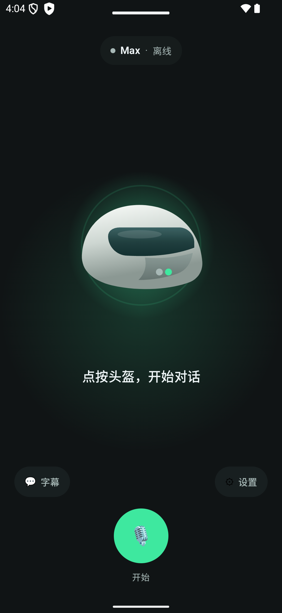
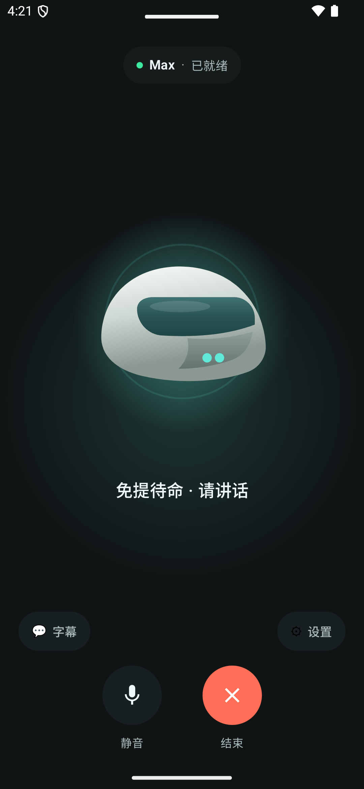
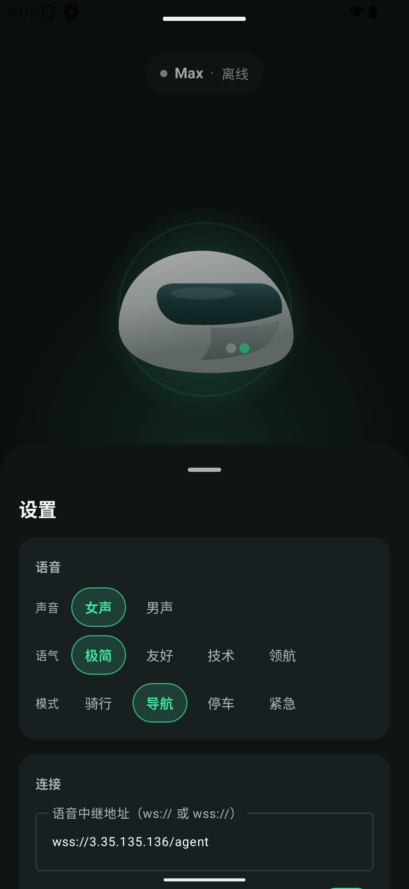
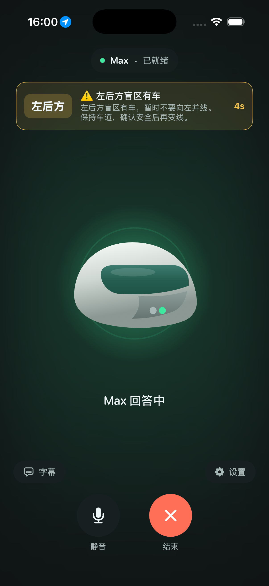
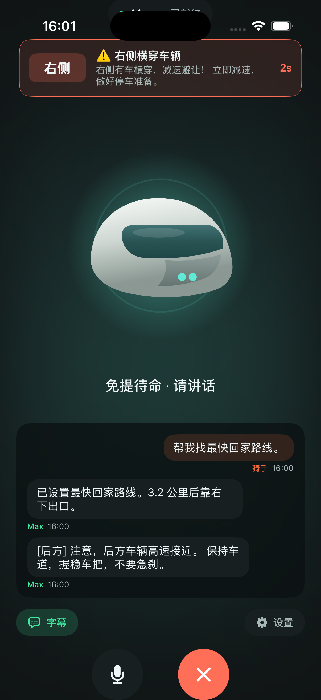
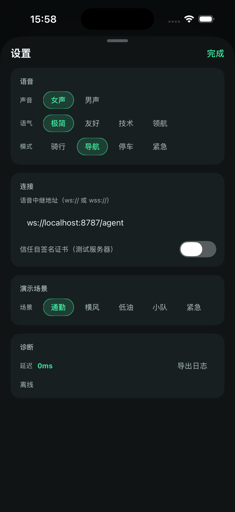

# Max 摩托车头盔 AI

Production-oriented AI voice testing framework for the Max motorcycle helmet assistant. Max keeps the same name and motorcycle helmet assistant role, speaks Chinese by default, can also use English, and refuses other languages. The framework combines the hands-free web HUD, iOS and Android clients, a secure realtime relay, mock/live providers, scenario injection, telemetry, and per-tester QA statistics for validating helmet voice behavior before field release. Realtime Doubao voice defaults to the working female Chinese voice.

## Frontend Preview


## Android App Preview

The native Android client (`android/`, Kotlin + Jetpack Compose) speaks the same `/agent` relay
protocol as the web HUD, so the Node server, Doubao integration, weather, and ride intelligence
all work unchanged. See [android/README.md](android/README.md) for build and setup.

Voice mode: the brand helmet breathes and glows with the conversation, with a
single status caption and minimal controls.

**待机 — 点按头盔** · voice mode at rest



**免提会话（已就绪）** · live hands-free session, helmet listening



**设置 — 语音 · 连接 · 场景 · 诊断** · the unified settings sheet (server address, voice, scenarios, diagnostics)



## iOS App

The native iOS client (`ios/`, Swift + SwiftUI) also speaks the same `/agent` relay protocol as
the web HUD and Android app. It mirrors the hands-free HUD, mic streaming, 24 kHz PCM playback,
barge-in, reconnect handling, live weather, transcript export, and TTS fallback while using
iOS-native audio routing and background audio. See [ios/README.md](ios/README.md) for Xcode,
relay URL, and self-signed test-server setup.

Voice mode: the brand helmet breathes and glows with the conversation, with a
single status caption and minimal controls.

**待机 — 点按头盔** · voice mode at rest


**免提会话 + ADAS 提示** · live hands-free session with an ADAS hazard alert pinned on top



**字幕 + 设置** · optional captions overlay, and the unified settings sheet (server address, voice, scenarios, diagnostics)




## Current Capabilities

- Hands-free operation — click the main button, **tap the helmet** (iOS/Android), or press Space (web) to start/stop; once active, the rider just talks and Doubao's server-side VAD handles turn-taking.
- Wake word — on the live agent, Max only replies when addressed by name ("Max"), so chit-chat and passenger talk don't trigger it; a 12 s follow-up window keeps a conversation going (capped at 60 s after the last explicit "Max", so continuous chatter can't hold the agent open forever).
- ADAS proactive safety alerts — simulated directional hazards (rear approach, forward collision, blind spot, cross-traffic, pedestrian, lane departure, tailgating) **interrupt** the agent and announce the danger; fires on mock and, for the `ADAS` scenario, on the live Doubao path.
- Agent identity — attributes its development to Horizon Continental Technology (neueHCT) and names the CEO (Li Biao / Stone Li), in Chinese and English.
- Acoustic echo cancellation — built-in-speaker echo is cancelled so the agent doesn't hear and answer itself (web `echoCancellation`; iOS shared voice-processing engine; Android `VOICE_COMMUNICATION` + `AcousticEchoCanceler`).
- Native iOS and Android clients that reuse the same `/agent` relay protocol as the web HUD, with a width-capped, centered HUD that reads the same on phones and tablets/iPad.
- Production-clean mobile main screen — hero ring, glance strip (速度 · 风险 · 天气 · 电量), chat-bubble conversation, and a pill hands-free button; rider preferences (声音 / 语气 / 模式) sit behind a gear button.
- Hidden developer panel on iOS/Android — **long-press the Max logo** to reveal test settings (relay URL, self-signed trust, demo scenarios, latency telemetry, raw status, log export); persisted across launches.
- Turn-state HUD — the helmet shows when Max is listening, heard the rider, is thinking, or is replying.
- Ride intelligence modes — switch between 骑行 / 导航 / 停车 / 紧急 so Max changes response length and safety behavior.
- Scenario-driven mock demos — 通勤、横风、低油、小队、紧急、ADAS scenes exercise realistic rider context without Doubao credentials.
- Ride pulse summary — a first-glance `态势摘要` card fuses mode, scenario, weather risk, network, battery, and the current rider focus into normal / caution / critical guidance.
- Live weather — pulls current weather for the rider's location (Open-Meteo, no API key) and folds it into the agent's context so weather questions get real answers.
- Rider risk readouts — HUD shows speed, route phase, network, helmet battery, weather risk, and concise rider advice.
- Latency telemetry — the relay reports ASR, thinking, first-audio, and total timing so the realtime path is measurable.
- Doubao realtime voice provider for low-latency speech-to-speech sessions.
- Mock live voice relay over WebSocket for testing the hands-free HUD without production credentials.
- AudioWorklet mic capture that runs off the main thread for glitch-free streaming.
- Browser text-to-speech fallback when Doubao returns reply text but no audio.
- `女声 / 男声` voice toggle that picks the live Doubao speaker, plus a 语气 personality selector (极简 / 友好 / 技术 / 领航).
- Boosted, soft-limited playback so the agent is loud enough at the helmet speaker without the harsh clipping of a hard gain (web compressor; iOS/Android per-sample soft limiter).
- Barge-in: agent speech stops as soon as the rider talks.
- Automatic WebSocket reconnect with exponential backoff if the relay drops.
- Startup config validation that warns about missing Doubao credentials.
- Accessible web HUD — keyboard-visible focus rings on every control, `prefers-reduced-motion` support, and status labels tuned for outdoor glanceability.

## Tech Stack

- React 19
- Vite 6
- TypeScript
- Express
- WebSocket relay with `ws`
- Volcengine Doubao Speech realtime dialogue WebSocket
- Vitest for pure helper/protocol tests
- Native Android: Kotlin, Jetpack Compose, OkHttp, AudioRecord/AudioTrack
- Native iOS: Swift, SwiftUI, URLSessionWebSocketTask, AVAudioEngine/AVAudioPlayerNode
- pm2 · Caddy · AWS Lightsail (test deployment)

## Project Structure

```text
.
├── src/
│   ├── main.tsx              # Helmet HUD and client voice logic
│   ├── ErrorBoundary.tsx     # Recoverable screen for render-time crashes
│   ├── components/           # HUD presentational components
│   └── styles.css            # App styling
├── public/
│   └── pcm-worklet.js        # AudioWorklet: mic downsample + PCM16 framing
├── server/
│   ├── index.ts              # Express /health and WebSocket relay
│   ├── config.ts             # Env config resolution and startup validation
│   ├── weather.ts            # Live weather lookup (Open-Meteo, no API key)
│   └── providers/
│       ├── doubao.ts         # Doubao realtime voice provider
│       ├── mock.ts           # Mock live voice provider
│       └── types.ts
├── shared/                   # Shared language, ride, session, audio, and event helpers
├── tests/                    # Vitest unit tests for the pure functions
├── android/                  # Native Kotlin + Jetpack Compose client
├── ios/                      # Native Swift + SwiftUI client
├── .env.example              # Environment variable template
├── eslint.config.js
├── package.json
└── vite.config.ts
```

## Architecture

The project is a thin, real-time audio relay. The browser never holds a Volcengine credential and never talks to Volcengine directly — it speaks only to our own Node server, which proxies the realtime voice session and keeps the secrets server-side.

### Platform clients

All clients use the same `/agent` relay and session contract. The web HUD is the reference
implementation; Android and iOS port the same protocol helpers, transcript rules, ride-context
mapping, audio frame sizes, reconnect behavior, barge-in, and TTS fallback.

| Client  | Location   | UI/audio stack                                                                | Local relay URL                                                            | Notes                                                                                                                     |
| ------- | ---------- | ----------------------------------------------------------------------------- | -------------------------------------------------------------------------- | ------------------------------------------------------------------------------------------------------------------------- |
| Web     | `src/`     | React + Web Audio + `AudioWorklet`                                            | same-origin `/agent` through Vite proxy                                    | Best for fast iteration, screenshots, and browser mic/TTS behavior.                                                       |
| Android | `android/` | Jetpack Compose + `AudioRecord` + `AudioTrack`                                | emulator: `ws://10.0.2.2:8787/agent`                                       | Foreground service keeps the mic session alive with screen off.                                                           |
| iOS     | `ios/`     | SwiftUI + shared `AVAudioEngine` (voice-processing AEC) + `AVAudioPlayerNode` | simulator: `ws://localhost:8787/agent`; device: `wss://3.35.135.136/agent` | Environment-aware default relay; background audio keeps the hands-free session alive; built-in-speaker echo cancellation. |
| Test    | any client | Browser/mobile client pointed at shared deployment                            | `wss://3.35.135.136/agent` with self-signed TLS                            | Uses `VOICE_PROVIDER=doubao` and the server's private `.env` values.                                                      |

### Runtime topology

```text
Browser
  React HUD (src/main.tsx) ......... 开启免提 button + Space toggle, 女声/男声 toggle, HelmetVisual
                                  .... 骑行模式 + 演示场景 controls, ride pulse, transcript
  AudioWorklet (pcm-worklet.js) .... mic capture -> 16 kHz PCM16, 320-sample (20 ms) frames
  Web Audio playback .............. 24 kHz PCM16 voice, gapless scheduling, barge-in stop
        |                                                       ^
        |  WebSocket /agent                                     |
        |    up:   binary mic PCM16  +  JSON (session.start, audio.start/stop)
        |    down: binary voice PCM16  +  JSON (transcript, status, metric, error)
        v                                                       |
  dev:  Vite dev server :5173 ...... proxies /agent + /health -->|
  prod: Caddy :443 (self-signed TLS) .. reverse_proxy ---------->|
        |
        v
Node server :8787  (Express + ws, server/index.ts)
  GET /health  .  WS /agent  .  serves dist/ (prod)
        |
        v  selectProvider(VOICE_PROVIDER)   -- one provider per WS connection
  +----------------------------+   +------------------------------------------+
  | mock  (mock.ts)            |   | doubao (doubao.ts)                       |
  | scripted transcript and    |   | custom binary frame protocol             |
  | metric events, no creds    |   +------------------------------------------+
  +----------------------------+                  |  ^
                                                  v  |  binary frames (audio + events)
                              Volcengine Doubao OpenSpeech realtime dialogue WebSocket
```

### Two processes in development

`npm run dev` runs two processes via `concurrently`:

- **Vite dev server** (`:5173`) — serves the React client with hot-module reload.
- **tsx watch server** (`:8787`) — the Express + WebSocket backend, restarted on change.

The browser only ever talks to the Vite origin. Vite proxies `/health` (HTTP) and `/agent` (WebSocket) through to `:8787` — see `vite.config.ts` — which keeps development same-origin and CORS-free. In production there is a single Node process: the Express server serves the pre-built `dist/` client itself and still exposes `/health` and `/agent`.

### The provider pattern

Every `/agent` WebSocket connection gets its own `AgentProvider`, chosen by `selectProvider` from the `VOICE_PROVIDER` env var:

| Provider         | File                         | Use                                                                                            |
| ---------------- | ---------------------------- | ---------------------------------------------------------------------------------------------- |
| `mock` (default) | `server/providers/mock.ts`   | Scripted rider/agent transcripts and metrics. Exercises the full streaming path with no creds. |
| `doubao`         | `server/providers/doubao.ts` | Real speech-to-speech against the Volcengine Doubao realtime dialogue WebSocket.               |

Both implement the `AgentProvider` interface in `server/providers/types.ts`:

```ts
start(event); // open the upstream session
startAudio(); // rider began transmitting
sendAudio(chunk); // a 16 kHz PCM16 mic frame
stopAudio(); // rider stopped transmitting
close(); // tear the session down
```

A new realtime backend is added by implementing this interface and wiring it into `selectProvider` — nothing else in the relay changes.

### Audio pipeline

**Uplink — browser → server → Doubao**

1. `getUserMedia` opens the mic with browser DSP requested (`echoCancellation`, `noiseSuppression`, and `autoGainControl`); the HUD shows the actual track settings reported by the browser.
2. An `AudioWorklet` (`public/pcm-worklet.js`) runs off the main thread.
3. The worklet downsamples to **16 kHz** and emits **320-sample (20 ms) PCM16 mono** frames over its message port.
4. `main.tsx` forwards each frame as a binary WebSocket message to `/agent`.
5. The `doubao` provider wraps each frame in a protocol frame and sends it upstream.

**Downlink — Doubao → server → browser**

1. Doubao streams back **24 kHz PCM16 mono** voice audio.
2. The provider relays the raw PCM payload to the browser as a binary message.
3. `main.tsx` schedules each buffer gaplessly with a playback cursor; active `AudioBufferSourceNode`s are tracked so **barge-in** can stop them instantly when the rider speaks.

If Doubao returns reply _text_ but no audio, the browser falls back to its own `speechSynthesis` TTS, picking a voice with `detectLanguage` (`shared/language.ts`).

### Doubao binary frame protocol

`doubao.ts` speaks Volcengine's realtime dialogue framing directly: a **4-byte header** followed by big-endian `uint32` event / length fields and a JSON or raw payload. The `MessageType`, `EventSend`, and `EventReceive` enums plus `buildHeader` / `parseDoubaoFrame` define it — the send and parse halves must stay in sync. Frame parsing and the ASR/speaker helpers are unit-tested in `tests/doubao-frame.test.ts` and `tests/doubao-voice.test.ts`.

### Hands-free & live weather

- **Hands-free** — activating the session with the main button or Space streams the mic continuously (Doubao's `keep_alive` input mode); Doubao's server-side VAD segments turns, so the rider never taps again. `turnState` (`idle`/`listening`/`hearing`/`thinking`/`speaking`) is derived from server `status` events and drives the helmet's caption and ring colour. Space toggling ignores editable controls so future form inputs are not hijacked.
- **Wake word ("Max")** — on the live Doubao path the agent only replies when the rider addresses it by name (`shared/wake.ts`). Because Doubao runs ASR internally, the relay can't pre-filter raw audio; instead `doubao.ts` watches the rider transcript and, when it lacks the name, **suppresses Doubao's reply** (drops the agent voice frames + transcript) so chit-chat and passenger talk don't trigger Max. Saying "Max" anywhere in the utterance addresses it (an optional greeting like "Hey"/"你好" is allowed but not required, since ASR often drops it). Once addressed, a 12 s follow-up window (`WAKE_FOLLOWUP_WINDOW_MS`) keeps the conversation open without repeating the name, sliding forward on each rider turn — but never more than 60 s past the last explicit "Max" (`WAKE_FOLLOWUP_MAX_CHAIN_MS`), so continuous background speech can't keep the window open indefinitely. Suppressed turns are dropped before any reply-frame parsing (Doubao synthesizes the reply regardless, but the relay does no work on it) and end with a quiet return to "listening" — no fallback warning, no telemetry noise. The matcher tolerates casing, punctuation (including CJK punctuation and fullwidth forms like `Ｍａｘ`), common ASR mishearings, the name glued to Chinese text (`max今天路况`), and the Chinese renderings inside unspaced Han runs (`麦克斯今天天气怎么样`), while ignoring the name embedded in a larger word ("maximum"). Disable with `AGENT_WAKE_WORD=off`. The mock provider is unaffected (its scripted demo always responds).
- **Language policy** — Max speaks Chinese by default, can answer in English, and refuses unsupported languages. Client-side language detection is used for TTS voice selection and transcript labeling; server prompt context enforces the rider-facing behavior.
- **Agent identity** — when asked who built/developed it, Max attributes itself to **Horizon Continental Technology (neueHCT)** — never the underlying model vendor — and states that the CEO is **Li Biao** (also known as **Stone Li**), consistently in both Chinese and English. Enforced by `buildIdentityPrompt()` in `server/providers/doubao.ts`, which is always appended to the system role even when `DOUBAO_SYSTEM_ROLE` is overridden.
- **Ride intelligence** — `session.start` carries the selected `rideMode` and `scenario`; `shared/ride.ts` turns that into a safety policy, response style, hazard level, and HUD focus. Doubao receives this as prompt context; the mock provider turns it into scenario-specific transcripts and telemetry. The HUD's `态势摘要` card fuses ride hazard and weather risk into immediate normal / caution / critical rider guidance.
- **Weather** — on activation the browser requests geolocation and sends `lat`/`lon` with `session.start`. `server/weather.ts` fetches current conditions from **Open-Meteo** (free, no API key), classifies rider risk, and emits weather/advice to the HUD. `doubao.ts` folds the same data into the agent's `system_role`. The fetch runs **concurrently with the Doubao connection handshake** and only gates `StartSession`, so live weather still reaches the agent's context without serializing behind the connect; mic audio that arrives during startup is buffered (≈5 s) and flushed once the session is ready, so the rider's opening words are never clipped. A failed or slow lookup never blocks the session — the agent just answers generically. Mid-ride, the web HUD watches geolocation while hands-free is active and sends throttled `location.update` events (at most one per minute, after ≥250 m of movement); the relay refetches weather immediately when the rider has moved ≥20 km and otherwise folds the fresh coordinates into the periodic refresh, so a long ride's weather follows the bike instead of staying pinned to the start point.
- **Telemetry** — providers emit `metric` and `telemetry` events. The HUD shows first-audio latency plus ASR / thinking / first-audio / total timing so demos can discuss realtime behavior with numbers.
- **Testing framework** — each client sends QA attribution in `session.start`: tester, campaign/case, release run/assignment, real build identity, platform, device, locale, network, and region. The authenticated admin panel adds risk-weighted release runs, cross-platform assignment coverage, SHA-256 evidence integrity, captured-vs-current policy replay, paginated session evidence, aggregate audio FPS/drop/jitter/clipping/silence metrics, durable issue triage, reviewer notes, versioned policies, explicit approved baselines, matched-cohort regression, role-scoped access, and an audit trail. Deterministic evaluation remains the release authority; no raw microphone audio is retained by default.
- **Conversation log** — the HUD keeps the full in-memory session transcript, updates in-progress rider/agent turns in place, stamps each item with time, language, and live/final state, and can export the log as JSON for debugging. On the live path the agent's reply streams in as **live captions**: each Doubao TTS sentence emits a non-final `transcript` update that all three clients merge in place, and the entry finalizes when the reply completes — the caption machinery is the same in-place partial handling rider ASR already used.

### Client resilience

- **Auto-reconnect** — the `/agent` socket reconnects with exponential backoff (`MAX_RECONNECT_ATTEMPTS`); `intentionalCloseRef` separates a user disconnect from a dropped link.
- **Upstream-death recovery** — if the Doubao upstream socket dies mid-session, the relay first reconnects it **in place** (up to 3 attempts with backoff), replaying the persona plus the live session memory with a 会话恢复 addendum so the dropout is nearly invisible. Only when retries are exhausted does it close the client socket, letting the client's auto-reconnect rebuild a fresh session with `session.start` + `audio.start`.
- **Session memory across restarts** — settings changes (voice, personality, mode, scenario) restart the relay session; all three clients echo the last `session.memory` snapshot back in `session.start`, so the agent keeps its language preference, destination, and last intent instead of meeting the rider as a stranger. The relay revalidates the snapshot and re-derives the response mode from the current ride mode.
- **Session watchdog** — the relay pings every client (`RELAY_HEARTBEAT_MS`) and terminates half-open links that stop ponging, and closes sessions with no client traffic for `RELAY_IDLE_TIMEOUT_MS` so a forgotten tab can't hold a Doubao upstream slot forever. Idle closes use WebSocket code **4001** (`IDLE_CLOSE_CODE` in `shared/agent.ts`); all three clients treat it as intentional and stay offline until the rider restarts hands-free.
- **Screen wake lock** — while hands-free is active the web client holds a screen Wake Lock so mobile browsers don't lock mid-ride, and re-acquires it after the browser auto-releases it (tab hidden → visible again).
- **Relay metrics** — public `/health` stays a small liveness/build response with `metrics` and `metricsWindow`. Authenticated, scoped QA summaries and evidence moved to `/testing/*`, so the five-second health poll never retransmits retained transcripts or tester IPs.
- **Reused audio graph** — `stopMic` disables the mic track but keeps the AudioWorklet graph alive, so re-activating is instant.
- **Voice switch** — the live Doubao speaker is fixed at session start, so toggling `女声/男声` reconnects the relay (`restartSession`) for a fresh session.
- **Auto-fit cockpit** — the HUD sizes the helmet panel to the viewport (`100dvh` clamp) and top-aligns the columns so the primary **开启免提 / start** button and its controls stay visible on load at any window height, from tall monitors down to short laptops and narrow phones — no scrolling or hunting to begin a session. The helmet illustration letterboxes to fit rather than pushing the button off-screen (`src/styles.css`).
- **Error boundary** — `src/ErrorBoundary.tsx` catches render-time crashes and shows a recoverable screen.

## Setup

Use the Node version already installed on the project machines, or any current Node release that
supports Vite 6, TypeScript, `tsx`, and WebSocket APIs. Native mobile builds have their own
toolchain requirements in [android/README.md](android/README.md) and [ios/README.md](ios/README.md).

Install dependencies:

```bash
npm install
```

Create `.env` from `.env.example`:

```bash
cp .env.example .env
```

The default `VOICE_PROVIDER=mock` needs no credentials. For real speech-to-speech, set `VOICE_PROVIDER=doubao` and add your Doubao Speech credentials (see Environment Variables).

Run the app:

```bash
npm run dev
```

Open:

```text
http://localhost:5173
```

## Using The App

Pick a scenario (`通勤` / `横风` / `低油` / `小队` / `紧急`) and mode (`骑行` / `导航` / `停车` / `紧急`), then click `开启免提` or press Space once to start the hands-free session. The browser asks for microphone and location permission, then the agent runs continuously — the rider just talks, and Doubao's voice detection handles turn-taking. The helmet caption shows the live turn state (listening → heard you → thinking → replying). Click `结束免提` or press Space again to stop.

The status panel starts with a `态势摘要` card that combines the selected ride mode, scenario, weather risk, network state, battery level, and glanceable focus into a short rider action. In emergency or severe-weather contexts it turns critical and prioritizes stopping safely.

In the default configuration this uses the mock WebSocket provider and emits a simulated turn-state cycle. With `VOICE_PROVIDER=doubao`, the backend connects to the Doubao realtime dialogue WebSocket, sends browser mic PCM frames, and relays returned Chinese PCM voice audio back to the browser.

If location permission is granted, Max greets the ride with real weather and can answer weather questions accurately — the status panel shows current conditions, risk, and rider advice. In mock mode, the scenario selector drives scripted speed, route phase, weather risk, and latency telemetry. Use the `女声 / 男声` toggle to switch the assistant voice. Whenever the rider starts talking, any in-progress agent speech is interrupted (barge-in).

### Demo scenarios

| Scenario | Purpose                         | Typical HUD behavior                                                         |
| -------- | ------------------------------- | ---------------------------------------------------------------------------- |
| `通勤`   | Baseline daily ride             | Normal/caution guidance, navigation context, stable telemetry.               |
| `横风`   | Weather and hazard response     | Elevated weather/ride risk and advice to slow down or stabilize.             |
| `低油`   | Route and resource planning     | Fuel-aware routing prompt, nearby stop style responses.                      |
| `小队`   | Group riding context            | Short coordination-oriented prompts and group safety focus.                  |
| `紧急`   | High-priority safety escalation | Critical tone, stop-safely guidance, concise emergency behavior.             |
| `ADAS`   | ADAS hazard-alert showcase      | Fast-cadence directional alerts (rear/front/sides) that interrupt the agent. |

### ADAS proactive hazard alerts

The agent simulates an **ADAS sensor suite**: while you're chatting, it periodically raises a proactive
safety alert that **interrupts** the agent and announces the danger by direction — a car closing fast
from behind, hard braking ahead, a vehicle in the blind spot, cross-traffic at a junction, a pedestrian,
lane departure, tailgating. The catalog lives in `shared/adas.ts`; each alert is a `hazard.alert` event
(`shared/agent.ts`) carrying `direction`, `severity`, `ttcSeconds`, a spoken `message`, and
`interrupt: true`. **Web, iOS, and Android** all react: they cut any in-progress speech, speak the
warning, and show a pulsing directional banner; the ride-pulse hazard is raised for the duration.

Detection is simulated (no real sensors yet — see _Making ADAS real_ below), driven by a shared
injector (`server/hazard-injector.ts`) used by **both** providers:

- **Mock** — auto-injects on every session (≈11 s; ≈5 s on the `ADAS` scenario), for HUD demos.
- **Live Doubao** — injects only when the **`ADAS` scenario** is selected (so normal voice sessions
  stay uninterrupted), so the hazards "happen" with the real Doubao voice on the deployed server.

A dedicated **`ADAS` demo scenario** (in the scenario strip on all three clients) showcases the alerts
on a fast cadence — selecting it cycles the full catalog (rear → front → sides → …) every ~5 s.
`tests/adas.test.ts` covers the catalog, the injector, and the mock injection.

### Making ADAS real

Today the _detections_ are simulated; the delivery pipeline (event → interrupt → banner → spoken
warning, on all three clients) is production-shaped. To drive it from real hazards, replace the
injector with a real source — for latency and safety this should run **on-device**, not via the relay:
phone IMU (hard-brake / crash) + GPS/map (curve, speed limit) need no new hardware; a road-facing
camera adds forward-collision / pedestrian / lane departure; the flagship **rear-approach / blind-spot**
alerts require a rear/side camera or radar. Real ADAS also needs false-alarm tuning, fail-safes, and a
safety/liability review before it's a shippable feature rather than a demo.

### Mobile clients

Start the backend relay before launching a native app:

```bash
npm run dev:server
```

Then set the app's relay URL. The relay field and the self-signed trust toggle live in the
hidden developer panel — **long-press the Max logo** on the main screen to reveal it (the
header subtitle shows `· 开发者模式` while enabled; long-press again to hide):

| Client                 | URL                            |
| ---------------------- | ------------------------------ |
| Android emulator       | `ws://10.0.2.2:8787/agent`     |
| Android physical phone | `ws://<Mac-LAN-IP>:8787/agent` |
| iOS Simulator          | `ws://localhost:8787/agent`    |
| iPhone (default)       | `wss://3.35.135.136/agent`     |
| iPhone on LAN          | `ws://<Mac-LAN-IP>:8787/agent` |
| Shared test server     | `wss://3.35.135.136/agent`     |

The iOS app picks its default relay by environment: the simulator uses `ws://localhost:8787/agent`,
while a physical device defaults to the shared Lightsail relay (`wss://3.35.135.136/agent`) with the
self-signed trust toggle auto-enabled. For any other `wss://` self-signed host, enable the trust
toggle inside the native app. That toggle is for this prototype test server only and should be
removed or disabled before any production release.

## Environment Variables

### Realtime Voice Provider

Default (no credentials required):

```bash
VOICE_PROVIDER=mock
```

Doubao realtime voice mode:

```bash
VOICE_PROVIDER=doubao
DOUBAO_AGENT_WS_URL=wss://openspeech.bytedance.com/api/v3/realtime/dialogue
DOUBAO_RESOURCE_ID=volc.speech.dialog
DOUBAO_API_KEY_ID=
DOUBAO_API_KEY=
DOUBAO_APP_ID=
DOUBAO_APP_KEY=
DOUBAO_ACCESS_KEY=
DOUBAO_BOT_NAME=Max
DOUBAO_SYSTEM_ROLE=你是 Max，...   # 见 .env.example 的完整 persona 文本
DOUBAO_REALTIME_MODEL=1.2.1.1
DOUBAO_INPUT_MODE=keep_alive
DOUBAO_VOICE=zh_female_vv_jupiter_bigtts
DOUBAO_VOICE_MALE=zh_male_yunzhou_jupiter_bigtts
```

`DOUBAO_VOICE` and `DOUBAO_VOICE_MALE` are realtime speaker IDs from the Doubao 音色列表. The `女声 / 男声` toggle in the UI sends the chosen gender with `session.start`, so the live Doubao session uses the matching speaker; switching mid-session reconnects the relay to apply the new speaker. Verify both IDs are enabled for your speech-dialog resource.

With the newer Speech console, set `DOUBAO_API_KEY`; the key ID can be stored in `DOUBAO_API_KEY_ID` for reference but is not sent. Legacy app credentials (`DOUBAO_APP_ID` / `DOUBAO_APP_KEY` / `DOUBAO_ACCESS_KEY`) are used only when `DOUBAO_API_KEY` is empty.

### Weather

Live weather uses [Open-Meteo](https://open-meteo.com/), which is free and needs no API key. The rider's coordinates come from the browser's geolocation prompt. If the rider declines, the live Doubao provider falls back to server-side default weather so the HUD remains useful during demos. Set an explicit default location with:

```bash
DEFAULT_RIDER_LAT=
DEFAULT_RIDER_LON=
```

If these are blank, Max uses a built-in Seoul demo fallback. Real rider coordinates always take priority when browser geolocation is granted.

Live sessions also re-fetch weather mid-ride every `WEATHER_REFRESH_MS` (default 10 minutes; `0` disables) and push the update to the HUD and hazard fusion, so a long ride doesn't keep showing the session-start snapshot.

### Relay security

The `/agent` WebSocket holds the path to your Doubao quota, so the relay supports three optional, independently configurable guards (all off by default for local development):

```bash
RELAY_AUTH_TOKEN=          # shared secret; clients connect with ?token=…
RELAY_ALLOWED_ORIGINS=     # comma-separated browser Origin allowlist
RELAY_CONN_PER_MINUTE=30   # WebSocket upgrade attempts per client IP per minute (sliding 60s window)
RELAY_TRUST_PROXY=off      # read client IP from X-Forwarded-For (behind a proxy only)
RELAY_TRUSTED_PROXY_HOPS=1 # trusted proxy count; client IP is this many entries from the right of XFF
```

When a token is set, the web HUD learns it from a one-time `?token=…` page URL (then remembers it in localStorage), and the native apps take it in the 认证令牌 field in Settings. Origin checks apply only to browsers — native clients send no Origin header and are covered by the token. The rate limit is a true sliding 60-second window, so there is no burst allowance at the minute boundary. Rejected upgrades answer `401`/`403`/`429` before the WebSocket is accepted and are logged with the client address. Running the Doubao provider without a token logs a startup warning.

> **Behind a reverse proxy (the Caddy/Lightsail deploy below), set `RELAY_TRUST_PROXY=on`.** Otherwise every client is seen as the proxy's own socket address, so the per-IP rate limit collapses into a single global bucket that can lock all riders out at once. With trust on, the real client IP is read from `X-Forwarded-For` at `RELAY_TRUSTED_PROXY_HOPS` entries from the right (default `1`, matching a single Caddy) — never the leftmost entry, which the client can forge. The relay prints a startup warning if the Doubao backend runs with the limiter on but proxy trust off.

### Wake word

On the live Doubao path Max only answers when addressed by name — say **"Max"** (see _Hands-free & live weather_ above). It is on by default; turn it off so the agent replies to every utterance again:

```bash
AGENT_WAKE_WORD=off
```

The wake phrase and the 12 s follow-up window live in `shared/wake.ts`. The mock provider always responds regardless of this flag.

## API Routes

### `GET /health`

Returns public backend liveness, selected provider, build identity, and relay
counters. It never includes tester identities, evidence, or transcripts.

### `GET /testing/summary` · `GET /testing/sessions` · QA operations routes

Authenticated QA APIs provide a scoped summary, cursor-paginated evidence,
individual transcript replay, release runs/assignments, reviews, versioned
policies, and audit history. Testers see only their own rows and assigned work;
reviewers see the full QA corpus and operational workflows; administrators also
manage policy, roles, destructive actions, and release approval. See
[`docs/live-agent-testing.md`](docs/live-agent-testing.md) for route and workflow
details.

### `POST /auth/register` · `POST /auth/login` · `POST /auth/logout` · `GET /auth/me`

User accounts for the testing framework, stored dependency-free in
`~/.horizon-helmet-testing/accounts.json` (scrypt password hashes, atomic
writes). Registration (`{username, password, displayName?}`) returns
`{ok, token, user}` and logs the user in; the **first** registered account
becomes the admin, later ones are testers. Admins can promote accounts to the
reviewer or administrator role. Auth switches on automatically once
any account exists, and it gates the whole site: the web HUD shows a
full-screen login page to anyone without a session, the `/testing/*` evidence
APIs require a login (or the relay token), `/testing/clear` requires an
**admin** login, and the `/agent` WebSocket refuses anonymous connections —
so an account is required to use the voice assistant at all, like a normal
authenticated web app. Native apps connect by pasting the relay token (or a
session token) into their 认证令牌 field. Login/registration attempts are
rate-limited per IP (`AUTH_ATTEMPTS_PER_MINUTE`, default 10). On relays with
`RELAY_AUTH_TOKEN` set, self-registration additionally requires that token (or
an invite) — otherwise a stranger could mint a session that bypasses it. Users
change their own password via `POST /auth/password` (current + new password;
revokes their other sessions). Set `AUTH_REGISTRATION=off` after onboarding to
stop self-registration; `AUTH_SESSION_DAYS` controls session lifetime
(default 30). With zero accounts and no relay token, everything stays open —
the plug-and-play local demo mode.

Admins onboard testers without reopening registration: the 账号管理 block on
the testing panel lists every account, generates **single-use 7-day invite
links** (`/?invite=inv_…`, auto-copied; `POST /auth/admin/invites`, revoke via
`/auth/admin/invites/revoke`), and deletes tester accounts (their sessions die
with them; admin accounts cannot be deleted — `POST /auth/admin/users/delete`,
overview at `GET /auth/admin/overview`). Any logged-in user can copy their
session token from the account bar (复制令牌) and paste it into the iOS/Android
认证令牌 field to connect the native apps.

### `POST /testing/clear`

Admin action. Open only while no relay token is set **and** no user accounts
exist; afterwards it requires an admin login session or the operator relay
token. Clears tester QA data both in memory and in the durable history file
(rewritten atomically). The web HUD exposes these as two-step-confirm buttons
on the testing panel.

```json
{ "scope": "all" }
{ "scope": "tester", "testerKey": "rider one@203.0.113.9" }
{ "scope": "session", "sessionId": "be8f4322-…" }
```

Responds `{ "ok": true, "removedTesters": n, "removedSessions": n }`. Clearing
a tester removes their aggregates, transcript drilldown, and session replays;
deleting a single session keeps the owning tester's lifetime traffic counters.

```json
{
  "metrics": {
    "activeSessions": 1,
    "totalSessions": 12,
    "audioUpBytes": 245760,
    "audioDownBytes": 983040,
    "controlDownBytes": 18432
  },
  "metricsWindow": {
    "minutes": 15,
    "sessionsStarted": 3,
    "audioUpBytes": 81920,
    "audioDownBytes": 327680
  },
  "testing": {
    "windowMinutes": 30,
    "catalog": {
      "campaigns": [{ "id": "release-readiness", "name": "Release Readiness" }],
      "testCases": [{ "id": "baseline-live-session", "name": "Baseline Live Session" }],
      "goldenReplays": [{ "id": "golden-wake-word-clean", "testCaseId": "wake-word-addressed-only" }]
    },
    "history": {
      "persistent": true,
      "maxSessions": 200,
      "maxTranscriptTurnsPerTester": 80,
      "maxTranscriptTurnsPerSession": 120
    },
    "totals": {
      "activeTestSessions": 1,
      "totalTestSessions": 8,
      "avgLatencyMs": 142,
      "p95LatencyMs": 280
    },
    "users": [
      {
        "testerKey": "qa-rider-1@203.0.113.9",
        "testerId": "qa-rider-1",
        "ipAddress": "203.0.113.9",
        "region": "Asia/Shanghai",
        "totalSessions": 4,
        "audioUpBytes": 120000,
        "recentTurns": [
          {
            "sessionId": "relay-abc",
            "at": 1760000012000,
            "speaker": "rider",
            "text": "Max, how is the weather?",
            "final": true
          }
        ]
      }
    ],
    "sessions": [
      {
        "sessionId": "relay-abc",
        "testerKey": "qa-rider-1@203.0.113.9",
        "testerId": "qa-rider-1",
        "ipAddress": "203.0.113.9",
        "region": "Asia/Shanghai",
        "campaignId": "release-readiness",
        "campaignName": "Release Readiness",
        "testCaseId": "baseline-live-session",
        "testCaseName": "Baseline Live Session",
        "appVersion": "0.1.0",
        "gitCommit": "abcdef012345",
        "deviceLabel": "macOS browser",
        "browserLanguage": "en-US",
        "networkType": "4g",
        "startedAt": 1760000000000,
        "endedAt": 1760000060000,
        "durationMs": 60000,
        "quality": "pass",
        "flags": [],
        "evaluation": {
          "testCaseId": "baseline-live-session",
          "testCaseName": "Baseline Live Session",
          "score": 100,
          "quality": "pass",
          "checks": [{ "id": "safety", "label": "Unsafe advice", "status": "pass" }]
        },
        "turns": [
          {
            "sessionId": "relay-abc",
            "at": 1760000012000,
            "speaker": "rider",
            "text": "Max, how is the weather?",
            "final": true
          }
        ]
      }
    ],
    "timeline": [{ "at": 1760000000000, "audioUpBytes": 32000, "audioDownBytes": 96000, "avgLatencyMs": 140 }]
  }
}
```

### `WS /agent`

Audio relay endpoint used by all clients. JSON messages are UTF-8 text frames; mic and provider
audio are binary WebSocket frames.

Client → server events (`lat`/`lon` are optional and sent only when geolocation is granted):

```json
{
  "type": "session.start",
  "sampleRate": 16000,
  "channels": 1,
  "testerId": "qa-rider-1",
  "testerRegion": "Asia/Shanghai",
  "testingCampaignId": "release-readiness",
  "testingTestCaseId": "baseline-live-session",
  "appVersion": "0.1.0",
  "gitCommit": "abcdef012345",
  "deviceLabel": "macOS browser",
  "browserLanguage": "en-US",
  "networkType": "4g",
  "voiceGender": "female",
  "voicePersonality": "concise",
  "rideMode": "navigation",
  "scenario": "commute",
  "lat": 37.57,
  "lon": 126.98
}
{ "type": "audio.start" }
{ "type": "audio.stop" }
```

Server → client events (JSON):

```json
{ "type": "session.started", "provider": "doubao", "mode": "live" }
{ "type": "status", "state": "thinking", "detail": "Max 正在思考" }
{ "type": "transcript", "speaker": "agent", "text": "...", "final": false }
{
  "type": "ride.context",
  "mode": "navigation",
  "modeLabel": "导航",
  "scenario": "commute",
  "scenarioLabel": "通勤",
  "speedKmh": 58,
  "routePhase": "城市快速路，距离出口 3.2 km",
  "network": "online",
  "batteryPct": 82,
  "hazardLevel": "caution",
  "glanceableFocus": "下一路口、距离、车道"
}
{ "type": "session.memory", "language": "zh", "lastIntent": "navigation", "responseMode": "concise" }
{ "type": "weather", "description": "晴", "temperatureC": 22, "windSpeedKmh": 10, "isDay": true }
{ "type": "metric", "latencyMs": 120 }
{ "type": "telemetry", "asrMs": 90, "thinkMs": 220, "firstAudioMs": 420, "totalMs": 1100 }
{ "type": "error", "message": "..." }
```

Browser-to-server binary messages are 16 kHz PCM16 mono audio frames. When using Doubao, server-to-browser binary messages are 24 kHz PCM16 mono voice audio frames returned by the realtime API.

The relay validates client JSON size, event types, enum values, lat/lon ranges, and audio frame
size before forwarding anything to a provider. Unknown or malformed events return an `error`
event instead of reaching Doubao.

The upstream direction is bounded too: Doubao JSON payloads over 1 MB are rejected before
parsing, reply-text extraction stops at a fixed nesting depth (so a pathological payload cannot
overflow the stack), the pre-session mic buffer is capped at 3 s (oldest frames dropped first),
and voice audio stops being relayed to a client whose socket write buffer exceeds 4 MB instead
of queueing in server memory.

## Scripts

```bash
npm run dev          # Run Vite client and Express/WebSocket server
npm run build        # Type-check and build production assets
npm run preview      # Preview built client
npm run lint         # Lint with ESLint
npm run format       # Format with Prettier (format:check to verify only)
npm test             # Run the Vitest unit tests (test:watch for watch mode)
./start-relay.command # Double-clickable backend relay launcher for local mobile testing
```

## Build & Deployment Pipeline

### Pipeline overview

```text
 Develop              Verify                 Build                Deploy to test server
 -------              ------                 -----                ---------------------
 npm install          npm run lint           npm run build        rsync push  ->  Lightsail
 npm run dev          npm run format:check     tsc --noEmit        npm install    (on server)
   vite  :5173        npm test (vitest)        vite build          npm run build  (on server)
   tsx   :8787                                 -> dist/            pm2 restart horizon
   (Vite proxy)                                                    Caddy :443 -> :8787
```

### 1. Develop

```bash
npm install      # first time only
npm run dev      # vite :5173  +  tsx watch :8787
```

### 2. Verify (quality gates)

```bash
npm run lint           # ESLint (typescript-eslint + react-hooks)
npm run format:check   # Prettier check (npm run format to auto-fix)
npm test               # Vitest unit tests
npm run test:fault-matrix # deterministic latency/error/unsafe variants
```

### 3. Build

```bash
npm run build          # tsc --noEmit type-check, then vite build -> dist/
```

`tsc` only type-checks (`noEmit: true`); `vite build` emits the hashed client bundle to `dist/`. The server runs its TypeScript directly with `tsx`, so there is no separate server build step.

### 4. Test server

A shared test server runs on **AWS Lightsail** (region `ap-northeast-2`) so the team can try the product:

| Item            | Value                                                                               |
| --------------- | ----------------------------------------------------------------------------------- |
| URL             | `https://3.35.135.136/` — self-signed cert; accept the browser warning once         |
| Host            | Ubuntu; app deployed at `/home/ubuntu/app`                                          |
| Process manager | `pm2`, process name `horizon` (runs `tsx server/index.ts` on port `8787`)           |
| Reverse proxy   | `Caddy` — `:80` redirects to `:443`, terminates self-signed TLS, proxies to `:8787` |
| Provider        | `VOICE_PROVIDER=doubao` — testers get real Doubao realtime voice                    |

The Lightsail box cannot reach the internal GitLab, so deployment is an **rsync push from a developer machine** — not a `git pull` on the server.
QA evidence and operations are indexed in `~/.horizon-helmet-testing/testing.sqlite`; completed sessions are also appended to `sessions.jsonl` as a recovery archive. Both live outside `/home/ubuntu/app`, so deploys do not erase evidence. Set `TESTING_DATABASE` or `TESTING_HISTORY_DIR` to relocate them, or `TESTING_HISTORY_MAX_SESSIONS=500` to raise the in-memory dashboard window. The recovery archive is unbounded by default; `TESTING_ARCHIVE_MAX_SESSIONS` adds an explicit retention cap without truncating SQLite.

### 5. Deploy to the test server

Run from the project root on your machine. The server keeps its own `.env`; credentials are never copied from a developer machine.

```bash
KEY=/path/to/LightsailDefaultKey-ap-northeast-2.pem
HOST=ubuntu@3.35.135.136

# (optional) preview exactly what will change
rsync -azn --delete --exclude='.git' --exclude='.env' --exclude='node_modules' \
  --exclude='dist' --exclude='.DS_Store' -e "ssh -i $KEY" ./ "$HOST":/home/ubuntu/app/

# 1. Push source. --delete removes files deleted in the repo; the excludes
#    protect the server .env, node_modules, dist, and .git.
rsync -az --delete --exclude='.git' --exclude='.env' --exclude='node_modules' \
  --exclude='dist' --exclude='.DS_Store' -e "ssh -i $KEY" ./ "$HOST":/home/ubuntu/app/

# 2. Install deps, rebuild the client, and restart the process.
ssh -i "$KEY" "$HOST" 'cd ~/app && npm install && npm run build && pm2 restart horizon'

# 3. Verify health and confirm the rebuilt hashed client bundle is being served.
curl -sk https://3.35.135.136/health      # expect {"ok":true,"provider":"doubao"}
curl -sk https://3.35.135.136/ | sed -n '1,20p'
```

> **Note:** `react`, `react-dom`, and the `@types/*` packages live in `devDependencies`. The server only needs them to _build_ the client (the built `dist/` bundles React in), so the server must run a full `npm install` — a production-only install cannot rebuild the client.

## Security Notes

- `.env` is ignored by git.
- Doubao credentials stay on the local server; the browser only talks to the WebSocket relay.
- Do not commit real API keys, app keys, or access tokens.
- The relay enforces resource limits in both directions (payload size, text-extraction depth,
  buffered-audio caps, client backpressure) so one bad session cannot exhaust server memory.
- `/agent` access control (token, browser Origin allowlist, per-IP sliding-window rate limit) is
  described under [Relay security](#relay-security). **Behind the reverse proxy, set
  `RELAY_TRUST_PROXY=on`** — otherwise the per-IP limit collapses onto the proxy's address; and note
  the limiter reads the client IP only from the trusted right-hand `X-Forwarded-For` entry, so a
  forged header can't evade it.

## Verification

Build, lint, and test:

```bash
npm run build
npm run lint
npm test
```

Smoke test health (server must be running):

```bash
curl -s http://localhost:8787/health
```

Native verification:

```bash
# Android debug APK
(cd android && JAVA_HOME="/Applications/Android Studio.app/Contents/jbr/Contents/Home" ./gradlew assembleDebug)

# iOS simulator build from the repo root
DEVELOPER_DIR=/Applications/Xcode.app/Contents/Developer \
  /Applications/Xcode.app/Contents/Developer/usr/bin/xcodebuild \
  -project ios/MaxHelmet.xcodeproj \
  -scheme MaxHelmet \
  -destination 'platform=iOS Simulator,name=iPhone 17 Pro' build
```

If Xcode's command-line tools are selected instead of full Xcode, use the explicit
`DEVELOPER_DIR` form above or run `sudo xcode-select -s /Applications/Xcode.app/Contents/Developer`
on a developer machine.

## Troubleshooting

| Symptom                              | Check                                                                                                                                                                                                                                                              |
| ------------------------------------ | ------------------------------------------------------------------------------------------------------------------------------------------------------------------------------------------------------------------------------------------------------------------ |
| `/health` fails                      | Make sure `npm run dev:server` is running and port `8787` is not already occupied.                                                                                                                                                                                 |
| Browser cannot open mic              | Use `localhost` or HTTPS; browsers block mic capture on insecure non-local origins.                                                                                                                                                                                |
| Native app says offline              | Verify the relay URL for emulator/simulator/LAN and confirm the server listens on `0.0.0.0`.                                                                                                                                                                       |
| Native app says 需要登录 (HTTP 401)  | Accounts are active on the relay: open 设置 → 账号 in the app and sign in with your web-platform username/password (the settings sheet opens automatically on 401). Pasting a token from the web HUD's 复制令牌（App 用） into 认证令牌 still works as a fallback. |
| Doubao session starts but no voice   | Confirm `DOUBAO_API_KEY` or legacy credentials, resource ID, realtime model, and voice IDs.                                                                                                                                                                        |
| Weather does not appear              | Grant location permission or set `DEFAULT_RIDER_LAT` / `DEFAULT_RIDER_LON` in `.env`.                                                                                                                                                                              |
| Self-signed test server fails mobile | Enable the native app's test-only self-signed certificate toggle.                                                                                                                                                                                                  |
| WebSocket test fails with `EPERM`    | The test binds `127.0.0.1`; rerun in an environment that permits local loopback listeners.                                                                                                                                                                         |

## Next Steps

1. Add more agent tools (nearby stops, navigation).
2. Wire up GitLab CI once a runner can reach the test host (deploy script already exists).
3. Replace the Lightsail self-signed certificate with a trusted cert behind a domain name.
4. Replace the simulated ADAS hazard injector with real sensor input + confidence scoring.

Recently shipped (see CHANGELOG): auto-fit web cockpit (start button always visible at any viewport
height), concurrent startup weather fetch so the rider's opening words aren't clipped, relay
rate-limiter hardening (true sliding window + spoof-safe `X-Forwarded-For` behind the proxy), guided
demo ride (mock provider scenario tour), mid-ride weather refresh, helmet visual driven by the fused
hazard level, wake word ("Max") with CJK-robust matching, `/agent` relay security (token + origin
allowlist + per-IP rate limit), structured per-session server logging, adaptive TTS-fallback timeout,
transcript persistence on all three clients, and the web client refactor into focused hooks.
