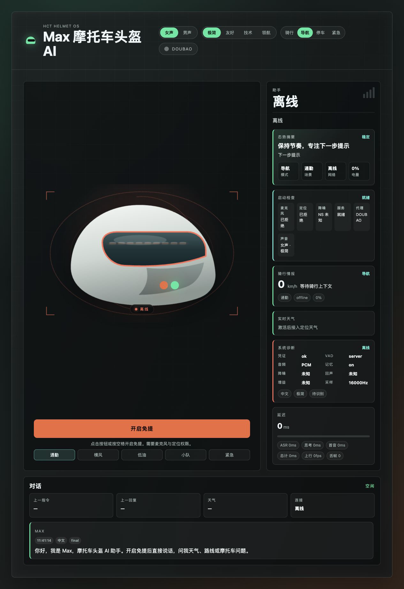

# Max 摩托车头盔 AI

Prototype AI voice agent for a motorcycle helmet. Max keeps the same name and motorcycle helmet assistant role, speaks Chinese by default, can also use English or Japanese, and refuses other languages. The app is a single live voice agent — start the mic and talk. Realtime Doubao voice defaults to the working female Chinese voice.

## Frontend Preview



## Current Capabilities

- Helmet HUD with a single mic toggle, connection status, latency readout, and a live transcript.
- Mock live voice relay over WebSocket for testing the streaming path without production credentials.
- Doubao realtime voice provider for low-latency speech-to-speech sessions.
- AudioWorklet mic capture that runs off the main thread for glitch-free streaming.
- Browser text-to-speech fallback when Doubao returns reply text but no audio.
- `女声 / 男声` voice toggle that picks the live Doubao speaker.
- Barge-in: agent speech stops as soon as the rider talks.
- Automatic WebSocket reconnect with exponential backoff if the relay drops.
- Startup config validation that warns about missing Doubao credentials.

## Tech Stack

- React 19
- Vite 6
- TypeScript
- Express
- WebSocket relay with `ws`
- Volcengine Doubao Speech realtime dialogue WebSocket

## Project Structure

```text
.
├── src/
│   ├── main.tsx              # Helmet HUD and client voice logic
│   ├── ErrorBoundary.tsx     # Recoverable screen for render-time crashes
│   ├── components/           # HUD presentational components
│   └── styles.css            # App styling
├── public/
│   └── pcm-worklet.js        # AudioWorklet: mic downsample + PCM16 framing
├── server/
│   ├── index.ts              # Express /health and WebSocket relay
│   ├── config.ts             # Env config resolution and startup validation
│   └── providers/
│       ├── doubao.ts         # Doubao realtime voice provider
│       ├── mock.ts           # Mock live voice provider
│       └── types.ts
├── shared/
│   └── language.ts           # TTS language detection helper
├── tests/                    # Vitest unit tests for the pure functions
├── .env.example              # Environment variable template
├── eslint.config.js
├── package.json
└── vite.config.ts
```

## Setup

Install dependencies:

```bash
npm install
```

Create `.env` from `.env.example`:

```bash
cp .env.example .env
```

The default `VOICE_PROVIDER=mock` needs no credentials. For real speech-to-speech, set `VOICE_PROVIDER=doubao` and add your Doubao Speech credentials (see Environment Variables).

Run the app:

```bash
npm run dev
```

Open:

```text
http://localhost:5173
```

## Using The App

Click `开始语音` to start the realtime voice agent. The button connects the relay, opens the mic, and streams audio; click `结束语音` to stop. In the default configuration this uses the mock WebSocket provider and emits simulated rider/agent transcript events. With `VOICE_PROVIDER=doubao`, the backend connects to the Doubao realtime dialogue WebSocket, sends browser mic PCM frames, and relays returned Chinese PCM voice audio back to the browser.

Use the `女声 / 男声` toggle to switch the assistant voice. Whenever the rider starts talking, any in-progress agent speech is interrupted (barge-in).

## Environment Variables

### Realtime Voice Provider

Default (no credentials required):

```bash
VOICE_PROVIDER=mock
```

Doubao realtime voice mode:

```bash
VOICE_PROVIDER=doubao
DOUBAO_AGENT_WS_URL=wss://openspeech.bytedance.com/api/v3/realtime/dialogue
DOUBAO_RESOURCE_ID=volc.speech.dialog
DOUBAO_API_KEY_ID=
DOUBAO_API_KEY=
DOUBAO_APP_ID=
DOUBAO_APP_KEY=
DOUBAO_ACCESS_KEY=
DOUBAO_BOT_NAME=Max
DOUBAO_SYSTEM_ROLE=你是 Max，...   # 见 .env.example 的完整 persona 文本
DOUBAO_REALTIME_MODEL=1.2.1.1
DOUBAO_INPUT_MODE=keep_alive
DOUBAO_VOICE=zh_female_vv_jupiter_bigtts
DOUBAO_VOICE_MALE=zh_male_yunzhou_jupiter_bigtts
```

`DOUBAO_VOICE` and `DOUBAO_VOICE_MALE` are realtime speaker IDs from the Doubao 音色列表. The `女声 / 男声` toggle in the UI sends the chosen gender with `session.start`, so the live Doubao session uses the matching speaker; switching mid-session reconnects the relay to apply the new speaker. Verify both IDs are enabled for your speech-dialog resource.

With the newer Speech console, set `DOUBAO_API_KEY`; the key ID can be stored in `DOUBAO_API_KEY_ID` for reference but is not sent. Legacy app credentials (`DOUBAO_APP_ID` / `DOUBAO_APP_KEY` / `DOUBAO_ACCESS_KEY`) are used only when `DOUBAO_API_KEY` is empty.

## API Routes

### `GET /health`

Returns backend health and the selected realtime voice provider.

### `WS /agent`

Browser audio relay endpoint used by `开始语音`.

Client events:

```json
{ "type": "session.start", "sampleRate": 16000, "channels": 1, "voiceGender": "female" }
{ "type": "audio.start" }
{ "type": "audio.stop" }
```

Browser-to-server binary messages are 16 kHz PCM16 mono audio frames. When using Doubao, server-to-browser binary messages are 24 kHz PCM16 mono voice audio frames returned by the realtime API.

## Scripts

```bash
npm run dev          # Run Vite client and Express/WebSocket server
npm run build        # Type-check and build production assets
npm run preview      # Preview built client
npm run lint         # Lint with ESLint
npm run format       # Format with Prettier (format:check to verify only)
npm test             # Run the Vitest unit tests (test:watch for watch mode)
```

## Security Notes

- `.env` is ignored by git.
- Doubao credentials stay on the local server; the browser only talks to the WebSocket relay.
- Do not commit real API keys, app keys, or access tokens.

## Verification

Build, lint, and test:

```bash
npm run build
npm run lint
npm test
```

Smoke test health (server must be running):

```bash
curl -s http://localhost:8787/health
```

## Next Steps

1. Replace mock latency values with real session telemetry.
2. Add a wake-word flow on top of the mic toggle.
3. Add richer realtime state labels for Doubao sessions.
