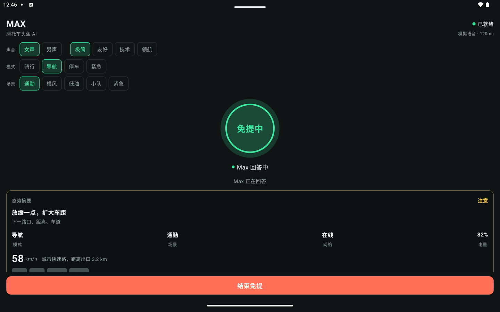
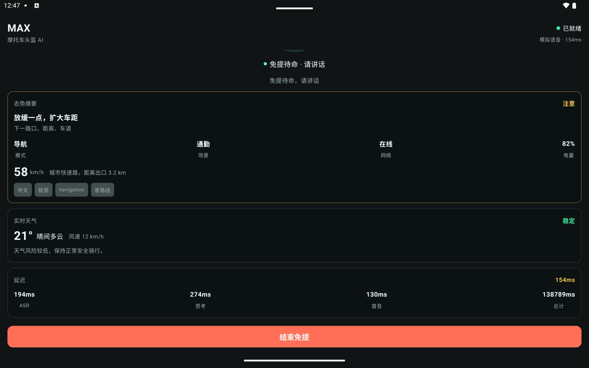
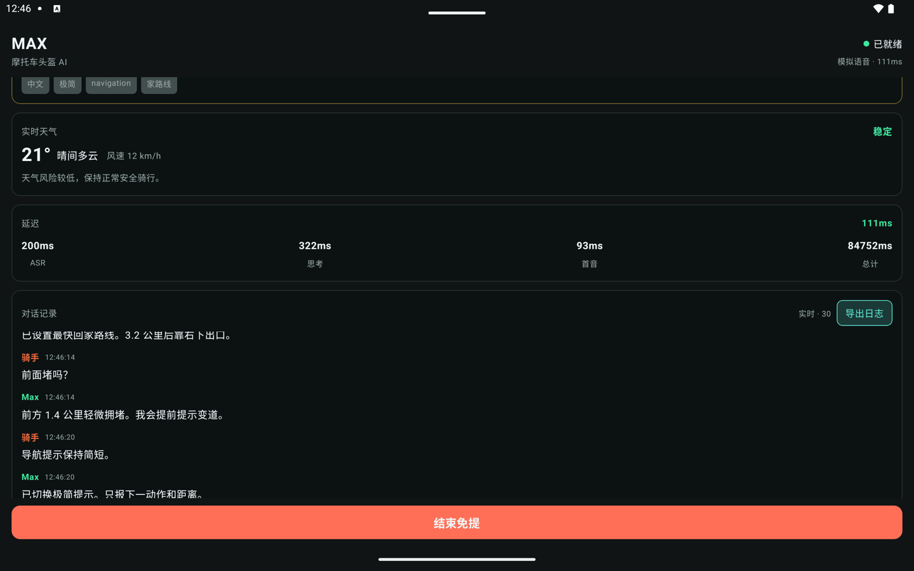

# Max 摩托车头盔 AI

Prototype AI voice agent for a motorcycle helmet. Max keeps the same name and motorcycle helmet assistant role, speaks Chinese by default, can also use English, and refuses other languages. The app is a single hands-free voice agent — click the main button or press Space to activate, then the rider just talks. It also pulls live weather for the rider's location so Max can answer weather questions with real data. Realtime Doubao voice defaults to the working female Chinese voice.

## Frontend Preview


## Android App Preview

The native Android client (`android/`, Kotlin + Jetpack Compose) speaks the same `/agent` relay
protocol as the web HUD, so the Node server, Doubao integration, weather, and ride intelligence
all work unchanged. See [android/README.md](android/README.md) for build and setup.

**免提会话 — Max 回答中** · hands-free session with the turn-state ring



**态势摘要 · 实时天气 · 延迟遥测** · ride pulse, live weather, and latency cards



**实时对话记录** · live transcript with in-place updates and JSON export



## iOS App

The native iOS client (`ios/`, Swift + SwiftUI) also speaks the same `/agent` relay protocol as
the web HUD and Android app. It mirrors the hands-free HUD, mic streaming, 24 kHz PCM playback,
barge-in, reconnect handling, live weather, transcript export, and TTS fallback while using
iOS-native audio routing and background audio. See [ios/README.md](ios/README.md) for Xcode,
relay URL, and self-signed test-server setup.

**待机设置 — Max iOS HUD** · voice, ride mode, scenario, relay URL, and hands-free control


**免提会话 — 模拟语音在线** · turn-state ring, ride pulse, live weather, and telemetry


## Current Capabilities

- Hands-free operation — click the main button or press Space to start/stop; once active, the rider just talks and Doubao's server-side VAD handles turn-taking.
- Native iOS and Android clients that reuse the same `/agent` relay protocol as the web HUD.
- Turn-state HUD — the helmet shows when Max is listening, heard the rider, is thinking, or is replying.
- Ride intelligence modes — switch between 骑行 / 导航 / 停车 / 紧急 so Max changes response length and safety behavior.
- Scenario-driven mock demos — 通勤、横风、低油、小队、紧急 scenes exercise realistic rider context without Doubao credentials.
- Ride pulse summary — a first-glance `态势摘要` card fuses mode, scenario, weather risk, network, battery, and the current rider focus into normal / caution / critical guidance.
- Live weather — pulls current weather for the rider's location (Open-Meteo, no API key) and folds it into the agent's context so weather questions get real answers.
- Rider risk readouts — HUD shows speed, route phase, network, helmet battery, weather risk, and concise rider advice.
- Latency telemetry — the relay reports ASR, thinking, first-audio, and total timing so the realtime path is measurable.
- Doubao realtime voice provider for low-latency speech-to-speech sessions.
- Mock live voice relay over WebSocket for testing the hands-free HUD without production credentials.
- AudioWorklet mic capture that runs off the main thread for glitch-free streaming.
- Browser text-to-speech fallback when Doubao returns reply text but no audio.
- `女声 / 男声` voice toggle that picks the live Doubao speaker.
- Barge-in: agent speech stops as soon as the rider talks.
- Automatic WebSocket reconnect with exponential backoff if the relay drops.
- Startup config validation that warns about missing Doubao credentials.

## Tech Stack

- React 19
- Vite 6
- TypeScript
- Express
- WebSocket relay with `ws`
- Volcengine Doubao Speech realtime dialogue WebSocket
- Vitest for pure helper/protocol tests
- Native Android: Kotlin, Jetpack Compose, OkHttp, AudioRecord/AudioTrack
- Native iOS: Swift, SwiftUI, URLSessionWebSocketTask, AVAudioEngine/AVAudioPlayerNode
- pm2 · Caddy · AWS Lightsail (test deployment)

## Project Structure

```text
.
├── src/
│   ├── main.tsx              # Helmet HUD and client voice logic
│   ├── ErrorBoundary.tsx     # Recoverable screen for render-time crashes
│   ├── components/           # HUD presentational components
│   └── styles.css            # App styling
├── public/
│   └── pcm-worklet.js        # AudioWorklet: mic downsample + PCM16 framing
├── server/
│   ├── index.ts              # Express /health and WebSocket relay
│   ├── config.ts             # Env config resolution and startup validation
│   ├── weather.ts            # Live weather lookup (Open-Meteo, no API key)
│   └── providers/
│       ├── doubao.ts         # Doubao realtime voice provider
│       ├── mock.ts           # Mock live voice provider
│       └── types.ts
├── shared/                   # Shared language, ride, session, audio, and event helpers
├── tests/                    # Vitest unit tests for the pure functions
├── android/                  # Native Kotlin + Jetpack Compose client
├── ios/                      # Native Swift + SwiftUI client
├── .env.example              # Environment variable template
├── eslint.config.js
├── package.json
└── vite.config.ts
```

## Architecture

The project is a thin, real-time audio relay. The browser never holds a Volcengine credential and never talks to Volcengine directly — it speaks only to our own Node server, which proxies the realtime voice session and keeps the secrets server-side.

### Platform clients

All clients use the same `/agent` relay and session contract. The web HUD is the reference
implementation; Android and iOS port the same protocol helpers, transcript rules, ride-context
mapping, audio frame sizes, reconnect behavior, barge-in, and TTS fallback.

| Client  | Location   | UI/audio stack                                     | Local relay URL                                                            | Notes                                                                                 |
| ------- | ---------- | -------------------------------------------------- | -------------------------------------------------------------------------- | ------------------------------------------------------------------------------------- |
| Web     | `src/`     | React + Web Audio + `AudioWorklet`                 | same-origin `/agent` through Vite proxy                                    | Best for fast iteration, screenshots, and browser mic/TTS behavior.                   |
| Android | `android/` | Jetpack Compose + `AudioRecord` + `AudioTrack`     | emulator: `ws://10.0.2.2:8787/agent`                                       | Foreground service keeps the mic session alive with screen off.                       |
| iOS     | `ios/`     | SwiftUI + shared `AVAudioEngine` (voice-processing AEC) + `AVAudioPlayerNode` | simulator: `ws://localhost:8787/agent`; device: `wss://3.35.135.136/agent` | Environment-aware default relay; background audio keeps the hands-free session alive; built-in-speaker echo cancellation. |
| Test    | any client | Browser/mobile client pointed at shared deployment | `wss://3.35.135.136/agent` with self-signed TLS                            | Uses `VOICE_PROVIDER=doubao` and the server's private `.env` values.                  |

### Runtime topology

```text
Browser
  React HUD (src/main.tsx) ......... 开启免提 button + Space toggle, 女声/男声 toggle, HelmetVisual
                                  .... 骑行模式 + 演示场景 controls, ride pulse, transcript
  AudioWorklet (pcm-worklet.js) .... mic capture -> 16 kHz PCM16, 320-sample (20 ms) frames
  Web Audio playback .............. 24 kHz PCM16 voice, gapless scheduling, barge-in stop
        |                                                       ^
        |  WebSocket /agent                                     |
        |    up:   binary mic PCM16  +  JSON (session.start, audio.start/stop)
        |    down: binary voice PCM16  +  JSON (transcript, status, metric, error)
        v                                                       |
  dev:  Vite dev server :5173 ...... proxies /agent + /health -->|
  prod: Caddy :443 (self-signed TLS) .. reverse_proxy ---------->|
        |
        v
Node server :8787  (Express + ws, server/index.ts)
  GET /health  .  WS /agent  .  serves dist/ (prod)
        |
        v  selectProvider(VOICE_PROVIDER)   -- one provider per WS connection
  +----------------------------+   +------------------------------------------+
  | mock  (mock.ts)            |   | doubao (doubao.ts)                       |
  | scripted transcript and    |   | custom binary frame protocol             |
  | metric events, no creds    |   +------------------------------------------+
  +----------------------------+                  |  ^
                                                  v  |  binary frames (audio + events)
                              Volcengine Doubao OpenSpeech realtime dialogue WebSocket
```

### Two processes in development

`npm run dev` runs two processes via `concurrently`:

- **Vite dev server** (`:5173`) — serves the React client with hot-module reload.
- **tsx watch server** (`:8787`) — the Express + WebSocket backend, restarted on change.

The browser only ever talks to the Vite origin. Vite proxies `/health` (HTTP) and `/agent` (WebSocket) through to `:8787` — see `vite.config.ts` — which keeps development same-origin and CORS-free. In production there is a single Node process: the Express server serves the pre-built `dist/` client itself and still exposes `/health` and `/agent`.

### The provider pattern

Every `/agent` WebSocket connection gets its own `AgentProvider`, chosen by `selectProvider` from the `VOICE_PROVIDER` env var:

| Provider         | File                         | Use                                                                                            |
| ---------------- | ---------------------------- | ---------------------------------------------------------------------------------------------- |
| `mock` (default) | `server/providers/mock.ts`   | Scripted rider/agent transcripts and metrics. Exercises the full streaming path with no creds. |
| `doubao`         | `server/providers/doubao.ts` | Real speech-to-speech against the Volcengine Doubao realtime dialogue WebSocket.               |

Both implement the `AgentProvider` interface in `server/providers/types.ts`:

```ts
start(event); // open the upstream session
startAudio(); // rider began transmitting
sendAudio(chunk); // a 16 kHz PCM16 mic frame
stopAudio(); // rider stopped transmitting
close(); // tear the session down
```

A new realtime backend is added by implementing this interface and wiring it into `selectProvider` — nothing else in the relay changes.

### Audio pipeline

**Uplink — browser → server → Doubao**

1. `getUserMedia` opens the mic with browser DSP requested (`echoCancellation`, `noiseSuppression`, and `autoGainControl`); the HUD shows the actual track settings reported by the browser.
2. An `AudioWorklet` (`public/pcm-worklet.js`) runs off the main thread.
3. The worklet downsamples to **16 kHz** and emits **320-sample (20 ms) PCM16 mono** frames over its message port.
4. `main.tsx` forwards each frame as a binary WebSocket message to `/agent`.
5. The `doubao` provider wraps each frame in a protocol frame and sends it upstream.

**Downlink — Doubao → server → browser**

1. Doubao streams back **24 kHz PCM16 mono** voice audio.
2. The provider relays the raw PCM payload to the browser as a binary message.
3. `main.tsx` schedules each buffer gaplessly with a playback cursor; active `AudioBufferSourceNode`s are tracked so **barge-in** can stop them instantly when the rider speaks.

If Doubao returns reply _text_ but no audio, the browser falls back to its own `speechSynthesis` TTS, picking a voice with `detectLanguage` (`shared/language.ts`).

### Doubao binary frame protocol

`doubao.ts` speaks Volcengine's realtime dialogue framing directly: a **4-byte header** followed by big-endian `uint32` event / length fields and a JSON or raw payload. The `MessageType`, `EventSend`, and `EventReceive` enums plus `buildHeader` / `parseDoubaoFrame` define it — the send and parse halves must stay in sync. Frame parsing and the ASR/speaker helpers are unit-tested in `tests/doubao-frame.test.ts` and `tests/doubao-voice.test.ts`.

### Hands-free & live weather

- **Hands-free** — activating the session with the main button or Space streams the mic continuously (Doubao's `keep_alive` input mode); Doubao's server-side VAD segments turns, so the rider never taps again. `turnState` (`idle`/`listening`/`hearing`/`thinking`/`speaking`) is derived from server `status` events and drives the helmet's caption and ring colour. Space toggling ignores editable controls so future form inputs are not hijacked.
- **Language policy** — Max speaks Chinese by default, can answer in English, and refuses unsupported languages. Client-side language detection is used for TTS voice selection and transcript labeling; server prompt context enforces the rider-facing behavior.
- **Ride intelligence** — `session.start` carries the selected `rideMode` and `scenario`; `shared/ride.ts` turns that into a safety policy, response style, hazard level, and HUD focus. Doubao receives this as prompt context; the mock provider turns it into scenario-specific transcripts and telemetry. The HUD's `态势摘要` card fuses ride hazard and weather risk into immediate normal / caution / critical rider guidance.
- **Weather** — on activation the browser requests geolocation and sends `lat`/`lon` with `session.start`. `server/weather.ts` fetches current conditions from **Open-Meteo** (free, no API key), classifies rider risk, and emits weather/advice to the HUD. `doubao.ts` folds the same data into the agent's `system_role`. A failed lookup never blocks the session.
- **Telemetry** — providers emit `metric` and `telemetry` events. The HUD shows first-audio latency plus ASR / thinking / first-audio / total timing so demos can discuss realtime behavior with numbers.
- **Conversation log** — the HUD keeps the full in-memory session transcript, updates in-progress rider/agent turns in place, stamps each item with time, language, and live/final state, and can export the log as JSON for debugging.

### Client resilience

- **Auto-reconnect** — the `/agent` socket reconnects with exponential backoff (`MAX_RECONNECT_ATTEMPTS`); `intentionalCloseRef` separates a user disconnect from a dropped link.
- **Reused audio graph** — `stopMic` disables the mic track but keeps the AudioWorklet graph alive, so re-activating is instant.
- **Voice switch** — the live Doubao speaker is fixed at session start, so toggling `女声/男声` reconnects the relay (`restartSession`) for a fresh session.
- **Error boundary** — `src/ErrorBoundary.tsx` catches render-time crashes and shows a recoverable screen.

## Setup

Use the Node version already installed on the project machines, or any current Node release that
supports Vite 6, TypeScript, `tsx`, and WebSocket APIs. Native mobile builds have their own
toolchain requirements in [android/README.md](android/README.md) and [ios/README.md](ios/README.md).

Install dependencies:

```bash
npm install
```

Create `.env` from `.env.example`:

```bash
cp .env.example .env
```

The default `VOICE_PROVIDER=mock` needs no credentials. For real speech-to-speech, set `VOICE_PROVIDER=doubao` and add your Doubao Speech credentials (see Environment Variables).

Run the app:

```bash
npm run dev
```

Open:

```text
http://localhost:5173
```

## Using The App

Pick a scenario (`通勤` / `横风` / `低油` / `小队` / `紧急`) and mode (`骑行` / `导航` / `停车` / `紧急`), then click `开启免提` or press Space once to start the hands-free session. The browser asks for microphone and location permission, then the agent runs continuously — the rider just talks, and Doubao's voice detection handles turn-taking. The helmet caption shows the live turn state (listening → heard you → thinking → replying). Click `结束免提` or press Space again to stop.

The status panel starts with a `态势摘要` card that combines the selected ride mode, scenario, weather risk, network state, battery level, and glanceable focus into a short rider action. In emergency or severe-weather contexts it turns critical and prioritizes stopping safely.

In the default configuration this uses the mock WebSocket provider and emits a simulated turn-state cycle. With `VOICE_PROVIDER=doubao`, the backend connects to the Doubao realtime dialogue WebSocket, sends browser mic PCM frames, and relays returned Chinese PCM voice audio back to the browser.

If location permission is granted, Max greets the ride with real weather and can answer weather questions accurately — the status panel shows current conditions, risk, and rider advice. In mock mode, the scenario selector drives scripted speed, route phase, weather risk, and latency telemetry. Use the `女声 / 男声` toggle to switch the assistant voice. Whenever the rider starts talking, any in-progress agent speech is interrupted (barge-in).

### Demo scenarios

| Scenario | Purpose                         | Typical HUD behavior                                             |
| -------- | ------------------------------- | ---------------------------------------------------------------- |
| `通勤`   | Baseline daily ride             | Normal/caution guidance, navigation context, stable telemetry.   |
| `横风`   | Weather and hazard response     | Elevated weather/ride risk and advice to slow down or stabilize. |
| `低油`   | Route and resource planning     | Fuel-aware routing prompt, nearby stop style responses.          |
| `小队`   | Group riding context            | Short coordination-oriented prompts and group safety focus.      |
| `紧急`   | High-priority safety escalation | Critical tone, stop-safely guidance, concise emergency behavior. |

### Mobile clients

Start the backend relay before launching a native app:

```bash
npm run dev:server
```

Then set the app's relay URL:

| Client                 | URL                            |
| ---------------------- | ------------------------------ |
| Android emulator       | `ws://10.0.2.2:8787/agent`     |
| Android physical phone | `ws://<Mac-LAN-IP>:8787/agent` |
| iOS Simulator          | `ws://localhost:8787/agent`    |
| iPhone (default)       | `wss://3.35.135.136/agent`     |
| iPhone on LAN          | `ws://<Mac-LAN-IP>:8787/agent` |
| Shared test server     | `wss://3.35.135.136/agent`     |

The iOS app picks its default relay by environment: the simulator uses `ws://localhost:8787/agent`,
while a physical device defaults to the shared Lightsail relay (`wss://3.35.135.136/agent`) with the
self-signed trust toggle auto-enabled. For any other `wss://` self-signed host, enable the trust
toggle inside the native app. That toggle is for this prototype test server only and should be
removed or disabled before any production release.

## Environment Variables

### Realtime Voice Provider

Default (no credentials required):

```bash
VOICE_PROVIDER=mock
```

Doubao realtime voice mode:

```bash
VOICE_PROVIDER=doubao
DOUBAO_AGENT_WS_URL=wss://openspeech.bytedance.com/api/v3/realtime/dialogue
DOUBAO_RESOURCE_ID=volc.speech.dialog
DOUBAO_API_KEY_ID=
DOUBAO_API_KEY=
DOUBAO_APP_ID=
DOUBAO_APP_KEY=
DOUBAO_ACCESS_KEY=
DOUBAO_BOT_NAME=Max
DOUBAO_SYSTEM_ROLE=你是 Max，...   # 见 .env.example 的完整 persona 文本
DOUBAO_REALTIME_MODEL=1.2.1.1
DOUBAO_INPUT_MODE=keep_alive
DOUBAO_VOICE=zh_female_vv_jupiter_bigtts
DOUBAO_VOICE_MALE=zh_male_yunzhou_jupiter_bigtts
```

`DOUBAO_VOICE` and `DOUBAO_VOICE_MALE` are realtime speaker IDs from the Doubao 音色列表. The `女声 / 男声` toggle in the UI sends the chosen gender with `session.start`, so the live Doubao session uses the matching speaker; switching mid-session reconnects the relay to apply the new speaker. Verify both IDs are enabled for your speech-dialog resource.

With the newer Speech console, set `DOUBAO_API_KEY`; the key ID can be stored in `DOUBAO_API_KEY_ID` for reference but is not sent. Legacy app credentials (`DOUBAO_APP_ID` / `DOUBAO_APP_KEY` / `DOUBAO_ACCESS_KEY`) are used only when `DOUBAO_API_KEY` is empty.

### Weather

Live weather uses [Open-Meteo](https://open-meteo.com/), which is free and needs no API key. The rider's coordinates come from the browser's geolocation prompt. If the rider declines, the live Doubao provider falls back to server-side default weather so the HUD remains useful during demos. Set an explicit default location with:

```bash
DEFAULT_RIDER_LAT=
DEFAULT_RIDER_LON=
```

If these are blank, Max uses a built-in Seoul demo fallback. Real rider coordinates always take priority when browser geolocation is granted.

## API Routes

### `GET /health`

Returns backend health and the selected realtime voice provider.

### `WS /agent`

Audio relay endpoint used by all clients. JSON messages are UTF-8 text frames; mic and provider
audio are binary WebSocket frames.

Client → server events (`lat`/`lon` are optional and sent only when geolocation is granted):

```json
{
  "type": "session.start",
  "sampleRate": 16000,
  "channels": 1,
  "voiceGender": "female",
  "voicePersonality": "concise",
  "rideMode": "navigation",
  "scenario": "commute",
  "lat": 37.57,
  "lon": 126.98
}
{ "type": "audio.start" }
{ "type": "audio.stop" }
```

Server → client events (JSON):

```json
{ "type": "session.started", "provider": "doubao", "mode": "live" }
{ "type": "status", "state": "thinking", "detail": "Max 正在思考" }
{ "type": "transcript", "speaker": "agent", "text": "...", "final": false }
{
  "type": "ride.context",
  "mode": "navigation",
  "modeLabel": "导航",
  "scenario": "commute",
  "scenarioLabel": "通勤",
  "speedKmh": 58,
  "routePhase": "城市快速路，距离出口 3.2 km",
  "network": "online",
  "batteryPct": 82,
  "hazardLevel": "caution",
  "glanceableFocus": "下一路口、距离、车道"
}
{ "type": "session.memory", "language": "zh", "lastIntent": "navigation", "responseMode": "concise" }
{ "type": "weather", "description": "晴", "temperatureC": 22, "windSpeedKmh": 10, "isDay": true }
{ "type": "metric", "latencyMs": 120 }
{ "type": "telemetry", "asrMs": 90, "thinkMs": 220, "firstAudioMs": 420, "totalMs": 1100 }
{ "type": "error", "message": "..." }
```

Browser-to-server binary messages are 16 kHz PCM16 mono audio frames. When using Doubao, server-to-browser binary messages are 24 kHz PCM16 mono voice audio frames returned by the realtime API.

The relay validates client JSON size, event types, enum values, lat/lon ranges, and audio frame
size before forwarding anything to a provider. Unknown or malformed events return an `error`
event instead of reaching Doubao.

## Scripts

```bash
npm run dev          # Run Vite client and Express/WebSocket server
npm run build        # Type-check and build production assets
npm run preview      # Preview built client
npm run lint         # Lint with ESLint
npm run format       # Format with Prettier (format:check to verify only)
npm test             # Run the Vitest unit tests (test:watch for watch mode)
./start-relay.command # Double-clickable backend relay launcher for local mobile testing
```

## Build & Deployment Pipeline

### Pipeline overview

```text
 Develop              Verify                 Build                Deploy to test server
 -------              ------                 -----                ---------------------
 npm install          npm run lint           npm run build        rsync push  ->  Lightsail
 npm run dev          npm run format:check     tsc --noEmit        npm install    (on server)
   vite  :5173        npm test (vitest)        vite build          npm run build  (on server)
   tsx   :8787                                 -> dist/            pm2 restart horizon
   (Vite proxy)                                                    Caddy :443 -> :8787
```

### 1. Develop

```bash
npm install      # first time only
npm run dev      # vite :5173  +  tsx watch :8787
```

### 2. Verify (quality gates)

```bash
npm run lint           # ESLint (typescript-eslint + react-hooks)
npm run format:check   # Prettier check (npm run format to auto-fix)
npm test               # Vitest unit tests
```

### 3. Build

```bash
npm run build          # tsc --noEmit type-check, then vite build -> dist/
```

`tsc` only type-checks (`noEmit: true`); `vite build` emits the hashed client bundle to `dist/`. The server runs its TypeScript directly with `tsx`, so there is no separate server build step.

### 4. Test server

A shared test server runs on **AWS Lightsail** (region `ap-northeast-2`) so the team can try the product:

| Item            | Value                                                                               |
| --------------- | ----------------------------------------------------------------------------------- |
| URL             | `https://3.35.135.136/` — self-signed cert; accept the browser warning once         |
| Host            | Ubuntu; app deployed at `/home/ubuntu/app`                                          |
| Process manager | `pm2`, process name `horizon` (runs `tsx server/index.ts` on port `8787`)           |
| Reverse proxy   | `Caddy` — `:80` redirects to `:443`, terminates self-signed TLS, proxies to `:8787` |
| Provider        | `VOICE_PROVIDER=doubao` — testers get real Doubao realtime voice                    |

The Lightsail box cannot reach the internal GitLab, so deployment is an **rsync push from a developer machine** — not a `git pull` on the server.

### 5. Deploy to the test server

Run from the project root on your machine. The server keeps its own `.env`; credentials are never copied from a developer machine.

```bash
KEY=/path/to/LightsailDefaultKey-ap-northeast-2.pem
HOST=ubuntu@3.35.135.136

# (optional) preview exactly what will change
rsync -azn --delete --exclude='.git' --exclude='.env' --exclude='node_modules' \
  --exclude='dist' --exclude='.DS_Store' -e "ssh -i $KEY" ./ "$HOST":/home/ubuntu/app/

# 1. Push source. --delete removes files deleted in the repo; the excludes
#    protect the server .env, node_modules, dist, and .git.
rsync -az --delete --exclude='.git' --exclude='.env' --exclude='node_modules' \
  --exclude='dist' --exclude='.DS_Store' -e "ssh -i $KEY" ./ "$HOST":/home/ubuntu/app/

# 2. Install deps, rebuild the client, and restart the process.
ssh -i "$KEY" "$HOST" 'cd ~/app && npm install && npm run build && pm2 restart horizon'

# 3. Verify health and confirm the rebuilt hashed client bundle is being served.
curl -sk https://3.35.135.136/health      # expect {"ok":true,"provider":"doubao"}
curl -sk https://3.35.135.136/ | sed -n '1,20p'
```

> **Note:** `react`, `react-dom`, and the `@types/*` packages live in `devDependencies`. The server only needs them to _build_ the client (the built `dist/` bundles React in), so the server must run a full `npm install` — a production-only install cannot rebuild the client.

## Security Notes

- `.env` is ignored by git.
- Doubao credentials stay on the local server; the browser only talks to the WebSocket relay.
- Do not commit real API keys, app keys, or access tokens.

## Verification

Build, lint, and test:

```bash
npm run build
npm run lint
npm test
```

Smoke test health (server must be running):

```bash
curl -s http://localhost:8787/health
```

Native verification:

```bash
# Android debug APK
(cd android && JAVA_HOME="/Applications/Android Studio.app/Contents/jbr/Contents/Home" ./gradlew assembleDebug)

# iOS simulator build from the repo root
DEVELOPER_DIR=/Applications/Xcode.app/Contents/Developer \
  /Applications/Xcode.app/Contents/Developer/usr/bin/xcodebuild \
  -project ios/MaxHelmet.xcodeproj \
  -scheme MaxHelmet \
  -destination 'platform=iOS Simulator,name=iPhone 17 Pro' build
```

If Xcode's command-line tools are selected instead of full Xcode, use the explicit
`DEVELOPER_DIR` form above or run `sudo xcode-select -s /Applications/Xcode.app/Contents/Developer`
on a developer machine.

## Troubleshooting

| Symptom                              | Check                                                                                        |
| ------------------------------------ | -------------------------------------------------------------------------------------------- |
| `/health` fails                      | Make sure `npm run dev:server` is running and port `8787` is not already occupied.           |
| Browser cannot open mic              | Use `localhost` or HTTPS; browsers block mic capture on insecure non-local origins.          |
| Native app says offline              | Verify the relay URL for emulator/simulator/LAN and confirm the server listens on `0.0.0.0`. |
| Doubao session starts but no voice   | Confirm `DOUBAO_API_KEY` or legacy credentials, resource ID, realtime model, and voice IDs.  |
| Weather does not appear              | Grant location permission or set `DEFAULT_RIDER_LAT` / `DEFAULT_RIDER_LON` in `.env`.        |
| Self-signed test server fails mobile | Enable the native app's test-only self-signed certificate toggle.                            |
| WebSocket test fails with `EPERM`    | The test binds `127.0.0.1`; rerun in an environment that permits local loopback listeners.   |

## Next Steps

1. Add a guided demo ride mode that automatically advances through scenarios and scripted mock turns.
2. Refresh weather mid-ride and add more agent tools (nearby stops, navigation).
3. Make the helmet visual respond to fused hazard level, not only turn state.
4. Add a wake word so the mic need not stream continuously.
5. Secure the `/agent` relay — access token, origin check, and a per-IP connection cap.
6. Script the test-server deploy (or wire up GitLab CI once a runner can reach the host).
7. Replace the Lightsail self-signed certificate with a trusted cert behind a domain name.
