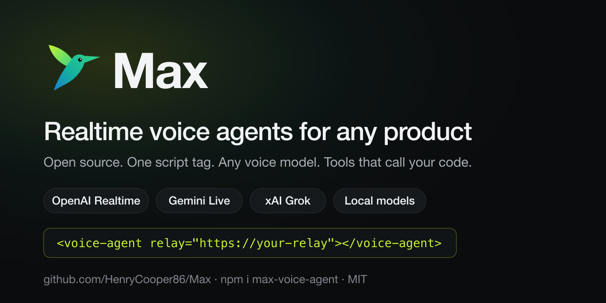

# Max：为任何产品接入实时语音智能体

简体中文 · [English](README.md)

[](https://www.npmjs.com/package/max-voice-agent)
[](LICENSE)
[](https://max.bionicloud.net)

[](https://max.bionicloud.net)

Max 是一套开源工具包，帮你把能说会听的 AI 智能体放进自己的产品：网站、Web 或移动应用、自助终端、可穿戴设备。你只需运行一个小型中继服务器：它保管你的 API 密钥，连接你选定的语音模型，并为所有客户端提供同一套简单的 WebSocket 协议。页面里用一个 script 标签、一个 React Hook 或几行 JavaScript 就能接入智能体，智能体在说话的同时还能调用你自己的代码和 API。

```html
<script src="https://voice.example.com/sdk/voice-agent.iife.js"></script>
<voice-agent relay="https://voice.example.com" token-url="/api/voice-token"></voice-agent>
```

- **任意语音模型，同一套接口。** 支持 OpenAI Realtime、Google Gemini Live、xAI Grok Voice、字节跳动豆包，也支持级联的语音转文字 → 任意聊天模型 → 文字转语音流水线，或完全本地运行的开源权重模型。改一个环境变量即可切换，客户端无需改动。
- **工具调用。** 智能体可以在说话途中查询信息、执行操作：可以是中继里的函数，也可以是任意语言后端的 webhook（带 HMAC 签名），还可以是页面本身的函数（滚动、填表、加入购物车）。
- **生产环境的细节都已处理。** 语音打断、回声消除、无间隙播放、保留对话的断线重连、文字输入、实时字幕、时延遥测、让浏览器永远接触不到密钥的短期会话令牌、来源白名单与限流。
- **覆盖所有平台。** 带现成组件的 Web SDK、原生 iOS 与 Android 客户端、Python 参考设备客户端和嵌入式 Linux 客户端，全部使用同一套[公开协议](docs/protocol.md)。
- **无需密钥即可试用。** 免密钥的演示后端可以跑通完整流程（包括工具调用），不必先注册任何服务。

## 快速开始

需要 Node.js 22.13 或更新版本。

```bash
git clone https://github.com/HenryCooper86/Max.git && cd Max
npm install
npm run build:sdk
```

用免密钥演示后端启动中继，并加载示例商店助手。中继令牌（relay token）是你自己的后端用来为浏览器签发短期令牌的密钥，本地开发时任意随机字符串都行：

```bash
RELAY_AUTH_TOKEN=dev-relay-secret TOOL_WEBHOOK_SECRET=dev-secret \
  ASSISTANT_CONFIG=examples/web-embed/assistant.config.json VOICE_PROVIDER=mock npx tsx server/index.ts
```

在第二个终端里，用同样的两个密钥启动示例商店（即你的“自有产品”）：

```bash
RELAY_AUTH_TOKEN=dev-relay-secret TOOL_WEBHOOK_SECRET=dev-secret node examples/web-embed/server.mjs
```

打开 <http://localhost:3000>，点击麦克风按钮。由于演示后端听不懂语音，请直接输入 `check stock {"product": "Trail Runner 2"}`，中继会调用一个代码工具；`get_order_status {"orderId": "A-1042"}` 会调用商店后端上带签名的 webhook；`show_product {"product": "storm-shell-jacket"}` 则会在页面内运行一个工具。

想真正开口对话，请换成真实后端重启中继：

```bash
RELAY_AUTH_TOKEN=dev-relay-secret TOOL_WEBHOOK_SECRET=dev-secret ASSISTANT_CONFIG=examples/web-embed/assistant.config.json \
  VOICE_PROVIDER=openai OPENAI_API_KEY=sk-... npx tsx server/index.ts
```

现在可以大声问：“Where is my order A-1042?”完整教程（包括配置你自己的助手和上线部署）见[快速上手](docs/getting-started.md)。

## 把智能体接入你的应用

**一个 script 标签。** 中继在 `/sdk/` 下提供 SDK。组件是一个悬浮的麦克风按钮，带实时转写，还可以带一个文字输入框。

```html
<script src="https://voice.example.com/sdk/voice-agent.iife.js"></script>
<voice-agent relay="https://voice.example.com" token-url="/api/voice-token" text-input></voice-agent>
```

**React。** 安装带类型的 SDK 包：

```bash
npm install max-voice-agent
```

```tsx
import { useVoiceAgent } from "max-voice-agent/react";

function Assistant() {
  const { status, transcript, start, stop } = useVoiceAgent({ url: "https://voice.example.com", token: fetchToken });
  return (
    <>
      <button onClick={status === "idle" ? start : stop}>{status === "idle" ? "Talk" : "Stop"}</button>
      {transcript.map((line) => (
        <p key={line.id}>
          {line.role}: {line.text}
        </p>
      ))}
    </>
  );
}
```

**原生 JavaScript**，用于自己的界面：

```js
import { VoiceAgent } from "max-voice-agent"; // or straight from your relay: https://voice.example.com/sdk/voice-agent.js

const agent = new VoiceAgent({ url: "https://voice.example.com", token: fetchToken, language: "en" });
agent.on("transcript", ({ transcript }) => render(transcript));
agent.on("status", (status) => (statusLabel.textContent = status));
talkButton.onclick = () => agent.start(); // from a click: browsers need a gesture for the microphone
```

`fetchToken` 向_你自己的_后端申请一个短期会话令牌，由你的后端用中继的密钥签发。每个选项、事件和方法见 [SDK 参考](sdk/README.md)。原生应用和设备请直接使用[协议](docs/protocol.md)。

## 给它配上工具

工具是智能体真正干活的方式。声明一次，所有支持函数调用的语音后端都能使用。

```ts
// agent-tools.ts: runs inside the relay ("toolsModule" in assistant.config.json)
import { defineTool, defineTools } from "./server/tools";

export default defineTools([
  defineTool<{ orderId: string }>({
    name: "get_order_status",
    description: "Look up an order by its number, for example A-1042.",
    parameters: { type: "object", properties: { orderId: { type: "string" } }, required: ["orderId"] },
    async handler({ orderId }, { userId, signal }) {
      return orders.lookup(orderId, { owner: userId, signal });
    }
  })
]);
```

```json
// assistant.config.json: a webhook tool, served by any backend in any language
{
  "tools": [
    {
      "name": "book_table",
      "description": "Book a table for a number of people at a time.",
      "parameters": {
        "type": "object",
        "properties": { "people": { "type": "integer" }, "time": { "type": "string" } },
        "required": ["people", "time"]
      },
      "webhook": { "url": "https://api.example.com/voice/book-table", "secret": "${BOOKING_WEBHOOK_SECRET}" }
    }
  ]
}
```

```js
// In the page: tools only the client can run
agent.tools = [
  {
    name: "add_to_cart",
    description: "Add a product to the shopping cart.",
    parameters: { type: "object", properties: { sku: { type: "string" } }, required: ["sku"] },
    handler: ({ sku }) => cart.add(sku)
  }
];
```

参数、错误、超时、签名，以及如何写出模型好用的工具，见[工具指南](docs/tools.md)。

## 选择语音后端

| `VOICE_PROVIDER` | 后端                                                               | 需要                                   | 工具 |
| ---------------- | ------------------------------------------------------------------ | -------------------------------------- | ---- |
| `mock`           | 免密钥演示（语音检测、文字轮次、真实工具调用）                     | 无                                     | 是¹  |
| `openai`         | OpenAI Realtime，语音到语音                                        | `OPENAI_API_KEY`                       | 是   |
| `gemini`         | Google Gemini Live，语音到语音                                     | `GEMINI_API_KEY`                       | 是   |
| `grok`           | xAI Grok Voice，语音到语音                                         | `XAI_API_KEY`                          | 是   |
| `doubao`         | 字节跳动豆包实时语音，中文表现最强                                 | `DOUBAO_API_KEY`                       | 否   |
| `pipeline`       | 语音转文字 → 任意 OpenAI 兼容聊天模型 → 文字转语音                 | `PIPELINE_API_KEY` 或 `OPENAI_API_KEY` | 是   |
| `local`          | 同一条流水线跑在你自己的硬件上（Whisper、Ollama、Kokoro）          | `LOCAL_VOICE=on`                       | 是   |
| `local-realtime` | 自托管、兼容 OpenAI Realtime 协议的服务器                          | `LOCAL_REALTIME_URL`                   | 是   |
| `max-speech`     | 我们自研的本地语音服务器：实时转写、智能轮次判断、任意本地聊天模型 | `MAX_SPEECH_URL` 或 `MAX_SPEECH=on`    | 是   |

¹ 适用于 `"device": "app"` 的助手。默认头盔助手的演示是一段预设的骑行脚本。

**完全本地运行。** `docker compose -f docker-compose.local-voice.yml up` 会启动 Max Speech 和 Ollama；在 Mac 上，`start-speech.command` 可以原生运行 Max Speech。不需要云账号，也不需要模型密钥。见[本地运行](docs/local-models.md)和[部署 Max Speech](docs/speech-server-deployment.md)。

模型、音色和端点都可以覆盖，见[语音后端](docs/backends.md)和[本地运行](docs/local-models.md)。中继允许时，客户端可以按会话选择后端。

## 工作原理

```text
 Your page / app / device                     Relay (this repo, Node.js)                  Voice model
 ┌───────────────────────┐   WebSocket /agent  ┌───────────────────────────────┐  vendor   ┌─────────────────┐
 │ <voice-agent>, SDK,   │ ──── mic PCM16 ───▶ │ auth: session tokens, origins │ ────────▶ │ OpenAI Realtime │
 │ iOS, Android, Python  │ ◀── voice PCM16 ─── │ session core: turns, barge-in,│ ◀──────── │ Gemini Live,    │
 │ client tools          │ ◀─ JSON events ───▶ │ wake word, memory, captions   │           │ Grok, Doubao,   │
 └───────────────────────┘   tool.call/result  │ tools: code, webhooks, client │           │ pipeline, local │
            ▲                                  └───────────────┬───────────────┘           └─────────────────┘
            │ session token                                    │ webhook (HMAC-signed)
 ┌──────────┴────────────┐                                     ▼
 │ Your backend          │ ◀──────────────────────────── your APIs and data
 └───────────────────────┘
```

浏览器和应用从不持有模型密钥。每个连接在你选定的后端上拥有独立的会话。用户感知到的“助手”行为，从轮次切换、打断到工具调用和字幕，都集中在同一个共享的会话核心里，所以无论接入哪个模型，表现都一致。

## 打造你自己的助手

助手的一切都写在一个文件 `assistant.config.json` 里：名称、用途（软件助手用 `"device": "app"`）、指令、问候语、语言、音色、外观和工具。运行 `npm run setup` 启动交互式向导，或在浏览器里通过 Admin → Studio 编辑。每个配置项见[配置参考](docs/configuration.md)。

```json
{
  "name": "Ava",
  "device": "app",
  "languages": ["en"],
  "greeting": "Hi, I'm Ava. What can I help you with?",
  "instructions": "You are the voice assistant of the Acme Outdoor web shop. Prices are in US dollars.",
  "toolsModule": "./agent-tools.ts"
}
```

没有配置文件时，中继运行的是 **Max**，也就是这套工具包的前身：摩托车头盔助手，配有 iOS、Android 和嵌入式客户端，以及导航、摄像头和危险预警。这个参考产品的文档见 [docs/max-helmet.md](docs/max-helmet.md)。

## 定价

Max 在 MIT 许可下免费开源，商业产品同样适用。付费方案增加的是服务，而不是功能：

| 方案           | 价格                                                              | 适用对象                                           |
| -------------- | ----------------------------------------------------------------- | -------------------------------------------------- |
| **开源版**     | 免费                                                              | 这里的一切，自行托管                               |
| **Max Cloud**  | ¥0.15/分钟（约 $0.02），使用自己的模型密钥，含 1,000 分钟免费额度 | 托管的中继，无需自己运维服务器。早期试用阶段需邀请 |
| **Enterprise** | 定制                                                              | 带 SLA 的支持、部署协助、定制集成                  |

详情见[定价与许可](docs/pricing.md)；如需邀请或 Enterprise，请发邮件到 [henry.cooper86@gmail.com](mailto:henry.cooper86@gmail.com)。要向自己的客户收费？中继会按用户统计语音分钟数，可以设置上限，还能把每次会话发送到你的计费系统，见[用量与计费](docs/usage-and-billing.md)。

## 文档

| 指南                                    | 内容                                                  |
| --------------------------------------- | ----------------------------------------------------- |
| [快速上手](docs/getting-started.md)     | 从克隆仓库到在自己的应用里跑起语音智能体，再到上线    |
| [Web SDK](sdk/README.md)                | 组件、`VoiceAgent`、React Hook、事件、客户端工具      |
| [工具](docs/tools.md)                   | 代码、webhook 和客户端工具；签名；如何写好工具        |
| [配置](docs/configuration.md)           | 每个 `assistant.config.json` 配置项和主要环境变量     |
| [语音后端](docs/backends.md)            | 每个后端及其设置，以及如何添加自己的后端              |
| [协议](docs/protocol.md)                | `/agent` WebSocket 协议，供任意语言的自定义客户端使用 |
| [安全](docs/security.md)                | 会话令牌、来源、webhook 签名、提示词注入防范建议      |
| [部署](docs/deployment.md)              | Docker、TLS 反向代理、扩容、健康检查                  |
| [用量与计费](docs/usage-and-billing.md) | 按用户统计分钟数、月度额度、计费 webhook、Stripe      |
| [定价与许可](docs/pricing.md)           | MIT 许可、Max Cloud 与 Enterprise                     |
| [运营 Max Cloud](docs/cloud.md)         | 账号、项目、预付费充值、微信支付与支付宝              |
| [硬件与音频](docs/audio/README.md)      | 把智能体装进你自己的设备：音频规范与测试台            |
| [本地运行](docs/local-models.md)        | 在自己的机器上运行开源权重的语音和聊天模型            |
| [示例](examples/README.md)              | 网上商店示例与 Python 设备客户端                      |

## 项目结构

```text
server/            The relay: auth, session core, voice engines, tools, Studio
  providers/live/  One file per voice engine, plus the shared session core
  tools/           Tool definitions, webhook runner, per-session broker
sdk/               Browser SDK: VoiceAgent, React hook, <voice-agent> widget
shared/            Protocol types shared by the relay and the web clients
protocol/          JSON Schema of the protocol; generates TS, Kotlin and Swift constants
src/               The relay's own web app: landing page, Studio, admin, helmet HUD
examples/          Runnable examples
ios/ android/ rdk/ Native and embedded clients of the reference helmet assistant
```

## 开发

```bash
npm run dev     # relay on :8787 and the web app on :5173 with hot reload
npm test        # unit tests
npm run check   # everything CI runs: protocol, format, lint, dead code, types, tests, build
```

欢迎贡献代码。请先阅读 [CONTRIBUTING.md](CONTRIBUTING.md)，安全问题请按 [SECURITY.md](SECURITY.md) 的说明私下报告。

## 许可证

[MIT](LICENSE)。商业产品和开源产品均可使用。
