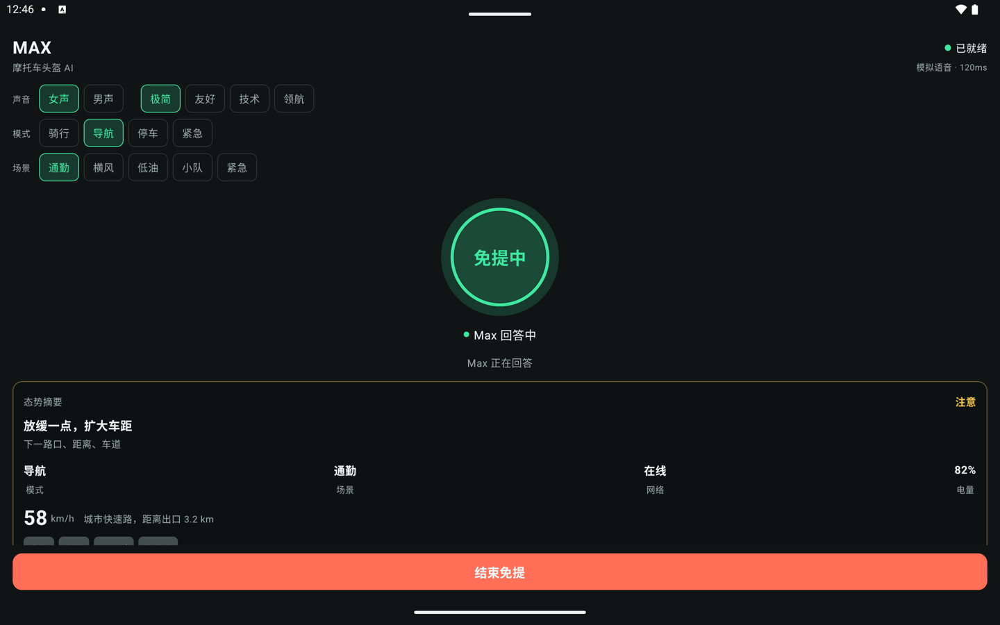
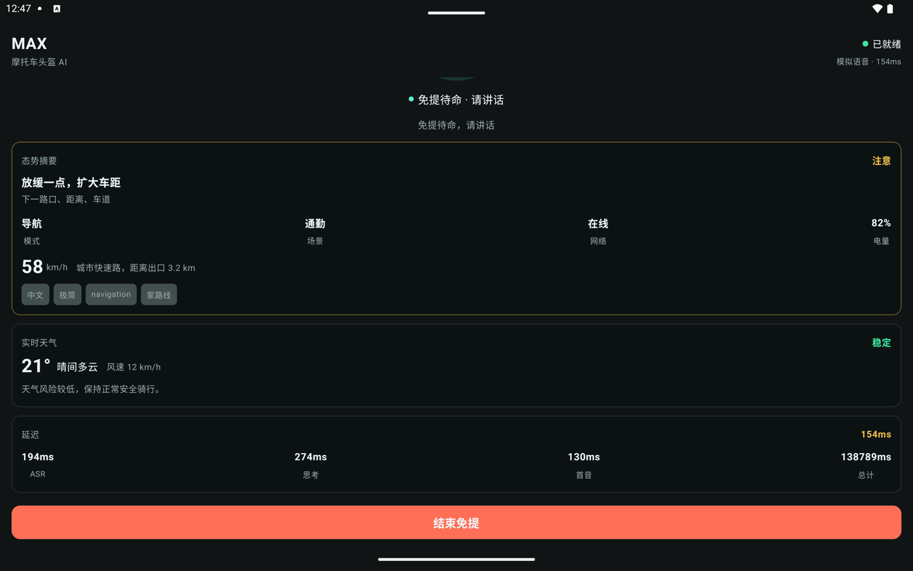
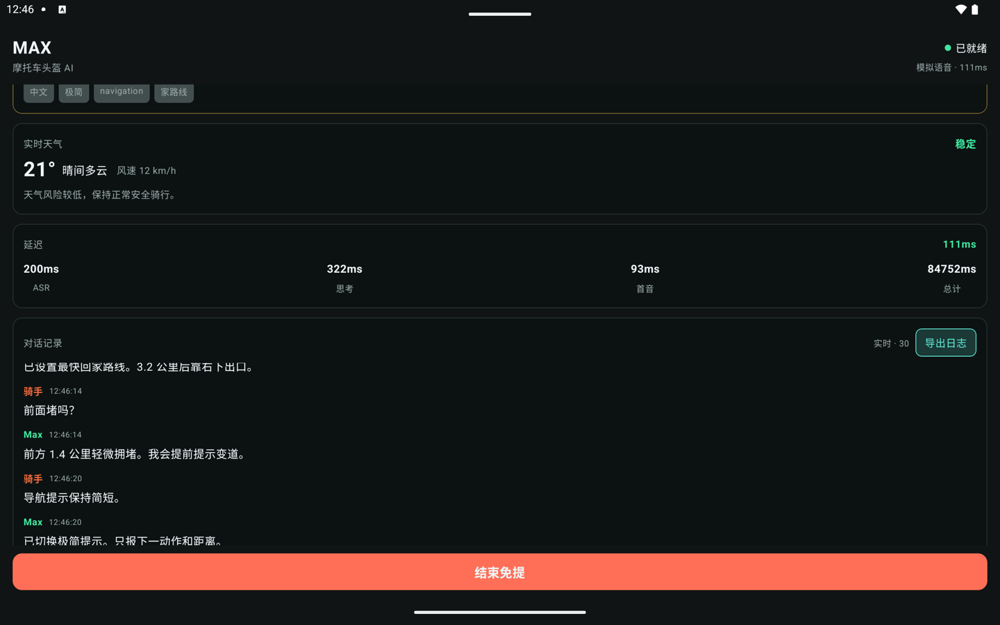

# Max 头盔助手 — Android App

Native Android (Kotlin + Jetpack Compose) client for the Max motorcycle helmet voice agent.
It speaks the same `/agent` relay protocol as the web HUD, so the Node server, Doubao
integration, weather, and ride intelligence all work unchanged — this app replaces only the
browser side.

```text
Phone (this app)                        Mac / test server
┌─────────────────────────┐            ┌──────────────────────┐
│ Jetpack Compose HUD     │            │ Express + ws relay   │
│ AudioRecord 16kHz PCM16 ├───────────▶│ /agent  (unchanged)  │
│ AudioTrack  24kHz PCM16 │◀───────────┤        │             │
│ Foreground service      │  binary +  │        ▼             │
│ Location → weather      │  JSON WS   │ Doubao OpenSpeech    │
└─────────────────────────┘            └──────────────────────┘
```

## Screenshots

| 免提会话（Max 回答中）                                         | 态势摘要 + 天气 + 延迟                                           | 实时对话记录                                              |
| -------------------------------------------------------------- | ---------------------------------------------------------------- | --------------------------------------------------------- |
|  |  |  |

## Requirements

- Android Studio with its bundled JBR/JDK. Gradle requires JDK 17-21; avoid Homebrew Java 25+.
- Android SDK with platform 34.
- A device or emulator running Android 8.0+ (API 26+)
- Gradle wrapper 9.4.1, Android Gradle Plugin 9.2.1, Kotlin 2.2.10, Compose BOM 2024.09.03.

## Build

From this `android/` directory:

```bash
JAVA_HOME="/Applications/Android Studio.app/Contents/jbr/Contents/Home" ./gradlew assembleDebug
```

The APK lands at `app/build/outputs/apk/debug/app-debug.apk`. Or open `android/` in
Android Studio and press Run.

Useful Gradle checks:

```bash
JAVA_HOME="/Applications/Android Studio.app/Contents/jbr/Contents/Home" ./gradlew assembleDebug
JAVA_HOME="/Applications/Android Studio.app/Contents/jbr/Contents/Home" ./gradlew lintDebug
```

## Run against the relay

1. Start the relay on the Mac: `npm run dev:server` (or `npm run dev`) from the repo root.
   The server listens on `0.0.0.0:8787`, so it is reachable over the LAN.
2. Install and launch the app, then set the 语音中继地址 field:

| Where the app runs   | Relay URL                                                         |
| -------------------- | ----------------------------------------------------------------- |
| Android emulator     | `ws://10.0.2.2:8787/agent` (default — host loopback)              |
| Physical phone (LAN) | `ws://<Mac-LAN-IP>:8787/agent`                                    |
| Physical phone (USB) | `ws://127.0.0.1:8787/agent` after `adb reverse tcp:8787 tcp:8787` |

3. Tap 开启免提. The app asks for microphone (required) and location (optional, used for
   live weather). With `VOICE_PROVIDER=mock` you get the scripted demo session; with
   `VOICE_PROVIDER=doubao` you get real speech-to-speech.

### Permissions

The manifest requests only the permissions needed for the prototype:

| Permission                      | Why it is needed                                                    |
| ------------------------------- | ------------------------------------------------------------------- |
| `INTERNET`                      | Connect to the local or test `/agent` WebSocket relay.              |
| `RECORD_AUDIO`                  | Stream the rider's microphone as 16 kHz PCM16 frames.               |
| `ACCESS_COARSE/FINE_LOCATION`   | Send coordinates to the relay for live weather and risk advice.     |
| `FOREGROUND_SERVICE_MICROPHONE` | Keep the hands-free mic session alive when the app is backgrounded. |
| `POST_NOTIFICATIONS`            | Show the foreground-service notification on newer Android versions. |
| `BLUETOOTH_CONNECT`             | Route audio to an in-helmet Bluetooth headset on Android 12+.       |
| `MODIFY_AUDIO_SETTINGS`         | Start/stop headset routing and speaker/mic mode adjustments.        |

Location is optional. If the rider denies it, the relay can still use server-side fallback
weather coordinates.

## Emulator quick start

```bash
# Terminal 1 — relay
npm run dev:server

# Terminal 2 — emulator + install
~/Library/Android/sdk/emulator/emulator -avd Medium_Tablet &
JAVA_HOME="/Applications/Android Studio.app/Contents/jbr/Contents/Home" ./gradlew installDebug
~/Library/Android/sdk/platform-tools/adb shell am start -n com.horizon.maxhelmet/.MainActivity
```

The emulator forwards the host Mac's microphone, so the full voice loop is testable.

## What's implemented (full HUD parity)

- Hands-free toggle: one button starts mic streaming + relay session (开启免提 / 结束免提)
- Turn-state ring with the web HUD's captions and palette (待机 / 请讲话 / 聆听 / 思考 / 回答)
- Live transcript with in-place partial updates and agent-line dedup (same rules as the web client)
- Transcript JSON export via the system share sheet (导出日志, same payload as the web export)
- Weather card with risk colour and rider advice
- 女声 / 男声 toggle — restarts the realtime session like the web `restartSession`
- 语气 (voice personality) selector: 极简 / 友好 / 技术 / 领航
- 骑行模式 selector (骑行 / 导航 / 停车 / 紧急) and 演示场景 strip (通勤 / 横风 / 低油 / 小队 / 紧急)
- 态势摘要 (ride pulse) card: fused ride + weather hazard, rider action, mode/scenario/network/battery
  grid, speed + route phase, session-memory chips
- Telemetry readouts: relay latency tone plus ASR / 思考 / 首音 / 总计 timings
- Barge-in: rider speech stops queued Doubao audio and device TTS
- ADAS hazard alerts: reacts to the server `hazard.alert` event by interrupting playback, speaking
  the warning, and showing a pulsing directional banner; a `预警` demo scenario showcases them
- Device-TTS fallback when the provider sends text without audio (mock provider, Doubao text-only replies)
- Auto-reconnect with exponential backoff (6 attempts, mirrors the web client)
- Foreground service so the session keeps running with the screen off
- Bluetooth headset (SCO) routing for in-helmet headsets, with phone mic/speaker fallback
- Acoustic echo cancellation: mic capture uses the `VOICE_COMMUNICATION` source plus
  `AcousticEchoCanceler` / `NoiseSuppressor`, so the agent's voice is not fed back into the
  mic (the Android analogue of the web's `getUserMedia({ echoCancellation })`). See *Audio
  notes* below for a known built-in-speaker limitation.
- `wss://` support with an opt-in "信任自签名证书" toggle for the Lightsail test server

## Protocol parity checklist

When changing shared web/server behavior, update Android at the same time:

- Event names and payloads in `shared/agent.ts` and `agent/AgentProtocol.kt`
- Ride modes, scenarios, hazard fusion, and prompt labels from `shared/ride.ts`
- Language detection and transcript normalization from `shared/language.ts` and `src/main.tsx`
- Audio frame assumptions: uplink 16 kHz PCM16 mono, 320 samples / 20 ms; downlink 24 kHz PCM16
- Reconnect/backoff behavior, barge-in behavior, and transcript JSON export payload
- Self-signed test-server handling and relay URL defaults

## Architecture

| File                           | Role                                                                               | Web counterpart                                                                      |
| ------------------------------ | ---------------------------------------------------------------------------------- | ------------------------------------------------------------------------------------ |
| `agent/AgentProtocol.kt`       | Event types, JSON parsing, ride/hazard/turn-state/language helpers, export payload | `shared/agent.ts`, `shared/ride.ts`, `shared/language.ts`, helpers in `src/main.tsx` |
| `agent/MicStreamer.kt`         | 16 kHz PCM16 mic capture, 20 ms frames; `VOICE_COMMUNICATION` source + `AcousticEchoCanceler` / `NoiseSuppressor` | `public/pcm-worklet.js`                                                              |
| `agent/PcmPlayer.kt`           | 24 kHz PCM16 gapless playback + barge-in flush                                     | playback scheduling in `src/main.tsx`                                                |
| `agent/AudioRouter.kt`         | Bluetooth headset (SCO) routing for in-helmet headsets                             | — (browsers can't control routing)                                                   |
| `agent/AgentSession.kt`        | Session orchestration, reconnect, transcript, state                                | `useHelmetAgent` hook in `src/main.tsx`                                              |
| `service/VoiceAgentService.kt` | Microphone foreground service                                                      | — (browser tabs can't do this)                                                       |
| `ui/AgentScreen.kt`            | Compose HUD: ring, ride pulse, telemetry, transcript, controls                     | `src/components/` + HUD layout in `src/main.tsx`                                     |

## Connecting to the Lightsail test server

Set the relay address to `wss://3.35.135.136/agent` and switch on 信任自签名证书 — the test
server's certificate is self-signed, so the toggle is required until it gets a trusted cert.

## Troubleshooting

| Symptom                              | Check                                                                                   |
| ------------------------------------ | --------------------------------------------------------------------------------------- |
| App stays offline in emulator        | Use `ws://10.0.2.2:8787/agent`, not `localhost`; `localhost` means the emulator itself. |
| Physical phone cannot connect        | Put phone and Mac on the same LAN, use the Mac LAN IP, and allow firewall access.       |
| USB device cannot connect            | Run `adb reverse tcp:8787 tcp:8787`, then use `ws://127.0.0.1:8787/agent`.              |
| Mic does not start                   | Grant microphone permission and confirm no other app is holding exclusive audio focus.  |
| Bluetooth headset is ignored         | Grant Bluetooth permission on Android 12+ and confirm the headset supports HFP/SCO.     |
| Test server TLS fails                | Use `wss://3.35.135.136/agent` and enable the self-signed certificate toggle.           |
| Build fails with Java version errors | Use Android Studio's JBR as `JAVA_HOME`; do not build with Homebrew Java 25+.           |

## Audio notes

- **Echo cancellation** is handled by the platform: `MicStreamer` records from
  `MediaRecorder.AudioSource.VOICE_COMMUNICATION` (which engages the device AEC/AGC/NS) and
  additionally attaches `AcousticEchoCanceler` + `NoiseSuppressor` to the record session. Unlike
  iOS's voice-processing unit — which only cancels audio rendered through the *same*
  `AVAudioEngine` — Android's `VOICE_COMMUNICATION` AEC references the actual speaker output at
  the HAL level, so capture and playback do **not** have to share one graph.
- **Known limitation (built-in speaker, no Bluetooth headset).** When no headset is routed,
  `AudioRouter.startVoiceRouting()` returns early without setting `MODE_IN_COMMUNICATION`, and
  `PcmPlayer` plays on `USAGE_MEDIA` (`PcmPlayer.useVoiceCall` is only `true` when Bluetooth is
  routed). That `MODE_NORMAL` + `USAGE_MEDIA` combination is the configuration where Android's
  AEC is least reliable, so some devices may leak residual echo on the phone speaker. It has not
  yet been reproduced on a physical device. The hardening fix — mirroring the iOS approach of
  keeping capture and playback on one echo-cancelled path — is to always use
  `MODE_IN_COMMUNICATION` + `USAGE_VOICE_COMMUNICATION` for the live session, not only when a
  headset is connected. Deferred pending a real-device test (AEC cannot be verified on an
  emulator, which does not model speaker→mic acoustic feedback).

## Release caveats

- The self-signed certificate trust toggle is for the shared test server only. Remove or harden
  it before release.
- The debug APK is unsigned for distribution. Configure a release signing key before shipping.
- `network_security_config.xml` permits development traffic; review it before production.
- Keep the foreground-service notification clear and user-visible for Android policy compliance.

## Not yet implemented (next steps)

- Uplink packet stats (fps / dropped frames) in the telemetry card
- Mid-ride weather refresh and continuous location updates
- A wake word so the mic need not stream continuously
- Unit tests for the protocol parsing and transcript dedup helpers
- Built-in-speaker echo hardening: always use `MODE_IN_COMMUNICATION` + `USAGE_VOICE_COMMUNICATION`
  for the live session (see *Audio notes*), pending a physical-device test
