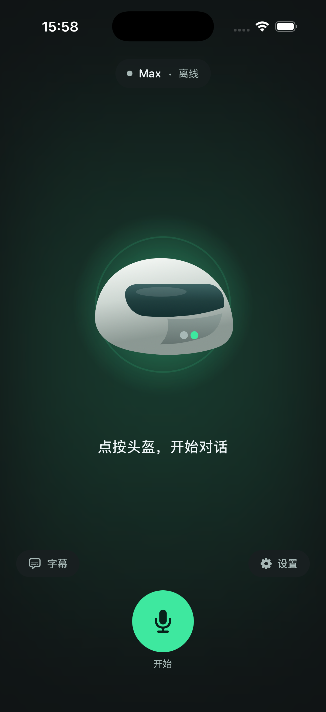
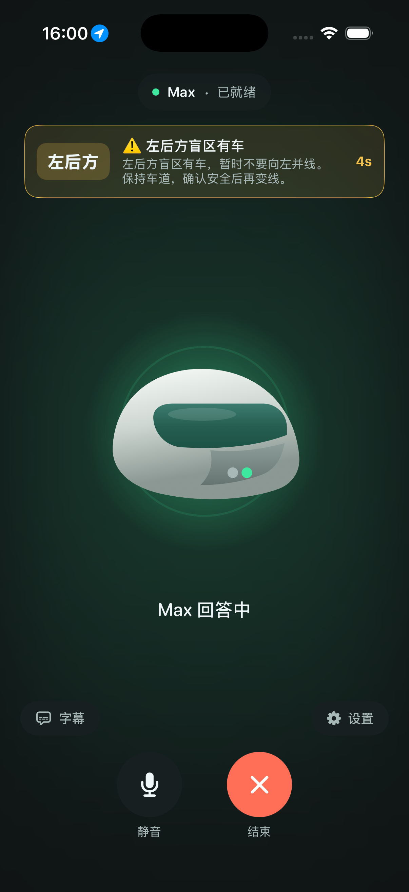

# Max 头盔助手 — iOS App

Native iOS (Swift + SwiftUI) client for the Max motorcycle helmet voice agent. It speaks the
same `/agent` relay protocol as the web HUD and the Android app, so the Node server, Doubao
integration, weather, and ride intelligence all work unchanged — this app replaces only the
client side.

```text
iPhone (this app)                       Mac / test server
┌─────────────────────────┐            ┌──────────────────────┐
│ SwiftUI HUD             │            │ Express + ws relay   │
│ AVAudioEngine 16kHz in  ├───────────▶│ /agent  (unchanged)  │
│ AVAudioPlayerNode 24kHz │◀───────────┤        │             │
│ Background audio mode   │  binary +  │        ▼             │
│ CoreLocation → weather  │  JSON WS   │ Doubao OpenSpeech    │
└─────────────────────────┘            └──────────────────────┘
```

## Screenshots

| 待机设置                                         | 免提会话                                             |
| ------------------------------------------------ | ---------------------------------------------------- |
|  |  |

## Requirements

- Xcode 16 or newer; Xcode 17 / iOS 26.5 simulator was used for the latest screenshots.
- iOS 17+ device or simulator
- An Apple Developer signing team for running on a physical device (Simulator needs none)

## Build & run

Open `MaxHelmet.xcodeproj` in Xcode and press Run — no extra tooling, CocoaPods, or SPM
packages. The project has no third-party dependencies; it uses only `SwiftUI`, `AVFoundation`,
`CoreLocation`, and `Combine`.

On a physical device, select your team under **Signing & Capabilities** first (the bundle ID is
`com.horizon.maxhelmet`; change it if it collides).

> New Swift files dropped into `MaxHelmet/` are picked up automatically — the target uses a
> synchronized group, so there is no "add to target" step.

Command-line simulator build from the repo root:

```bash
DEVELOPER_DIR=/Applications/Xcode.app/Contents/Developer \
  /Applications/Xcode.app/Contents/Developer/usr/bin/xcodebuild \
  -project ios/MaxHelmet.xcodeproj \
  -scheme MaxHelmet \
  -destination 'platform=iOS Simulator,name=iPhone 17 Pro' build
```

If `xcodebuild` reports that the active developer directory is Command Line Tools, use the
explicit `DEVELOPER_DIR` command above or switch the machine to full Xcode with `xcode-select`.

## Run against the relay

1. Start the relay on the Mac: `npm run dev:server` (or `npm run dev`) from the repo root.
   The server listens on `0.0.0.0:8787`, so it is reachable over the LAN.
2. Launch the app. The 语音中继地址 field is prefilled from an environment-aware default
   (`MainViewModel.defaultRelayURL`) — override it for any of the rows below:

| Where the app runs    | Relay URL                                           | Default?                       |
| --------------------- | --------------------------------------------------- | ------------------------------ |
| iOS Simulator         | `ws://localhost:8787/agent`                         | ✅ on the simulator            |
| Physical iPhone       | `wss://3.35.135.136/agent` (Lightsail, self-signed) | ✅ on a device (trust auto-on) |
| Physical iPhone (LAN) | `ws://<Mac-LAN-IP>:8787/agent`                      | override for a local Mac relay |

On a physical device `localhost` is the phone itself, so the app defaults to the shared AWS
Lightsail test relay and turns the self-signed trust toggle on for that first connection.
Point it back at a Mac relay by typing the LAN URL (and toggling self-signed off for `ws://`).

3. Tap 开启免提. The app asks for microphone (required) and location (optional, used for live
   weather). With `VOICE_PROVIDER=mock` you get the scripted demo session; with
   `VOICE_PROVIDER=doubao` you get real speech-to-speech.

### Simulator quick start

```bash
# Terminal 1 — relay
npm run dev:server

# Terminal 2 — build, install, and launch
DEVICE="iPhone 17 Pro"
DEVELOPER_DIR=/Applications/Xcode.app/Contents/Developer \
  /Applications/Xcode.app/Contents/Developer/usr/bin/xcodebuild \
  -project ios/MaxHelmet.xcodeproj \
  -scheme MaxHelmet \
  -destination "platform=iOS Simulator,name=$DEVICE" build

DEVELOPER_DIR=/Applications/Xcode.app/Contents/Developer /usr/bin/xcrun simctl boot "$DEVICE"
DEVELOPER_DIR=/Applications/Xcode.app/Contents/Developer /usr/bin/xcrun simctl install "$DEVICE" \
  ~/Library/Developer/Xcode/DerivedData/MaxHelmet-*/Build/Products/Debug-iphonesimulator/MaxHelmet.app
DEVELOPER_DIR=/Applications/Xcode.app/Contents/Developer /usr/bin/xcrun simctl launch "$DEVICE" \
  com.horizon.maxhelmet
```

The simulator can connect to the Mac relay at `ws://localhost:8787/agent`.

### Physical device quick start

Running on a real iPhone needs a signing team. With a **free** Apple ID, add it once in
**Xcode ▸ Settings ▸ Accounts**, then select your **(Personal Team)** under the MaxHelmet target's
**Signing & Capabilities** so Xcode provisions an _Apple Development_ certificate. The repo already
pins `DEVELOPMENT_TEAM = V487HQQLC6`; change it to your own team if you are not on that account.

```bash
# Find your connected device's UDID
DEVELOPER_DIR=/Applications/Xcode.app/Contents/Developer xcrun devicectl list devices

UDID=<your-device-udid>
export DEVELOPER_DIR=/Applications/Xcode.app/Contents/Developer

# Build, install, and launch on the device
xcodebuild -project ios/MaxHelmet.xcodeproj -scheme MaxHelmet \
  -destination "id=$UDID" -configuration Debug \
  -derivedDataPath /tmp/MaxHelmetBuild -allowProvisioningUpdates build
xcrun devicectl device install app --device "$UDID" \
  /tmp/MaxHelmetBuild/Build/Products/Debug-iphoneos/MaxHelmet.app
xcrun devicectl device process launch --device "$UDID" com.horizon.maxhelmet
```

The device must have **Developer Mode** enabled (Settings ▸ Privacy & Security ▸ Developer Mode).
On the first launch, trust the developer under **Settings ▸ General ▸ VPN & Device Management** if
iOS shows an "Untrusted Developer" prompt. A free personal team's signature **expires after 7 days** —
re-run the build/install to refresh it. The installed app defaults to the Lightsail relay above.

### Permissions

| Permission / capability               | Why it is needed                                                        |
| ------------------------------------- | ----------------------------------------------------------------------- |
| `NSMicrophoneUsageDescription`        | Stream rider speech to the relay.                                       |
| `NSLocationWhenInUseUsageDescription` | Send coordinates for weather and ride-risk context.                     |
| `NSLocalNetworkUsageDescription`      | Connect to a relay running on the same LAN during local development.    |
| `UIBackgroundModes = audio`           | Keep mic/playback active when the app is backgrounded or screen sleeps. |
| `NSAllowsArbitraryLoads`              | Prototype-only support for `ws://` dev relays and self-signed testing.  |

Location is optional. If denied, the server can use fallback weather coordinates.

### Self-signed test server

The Lightsail test box uses a self-signed certificate. The toggle **信任自签名证书（测试服务器）**
gates a trust-all path for `wss://` hosts with such a cert. On a physical device it defaults **on**
(via `MainViewModel.defaultAllowSelfSigned`) so the Lightsail default relay connects out of the box;
the simulator defaults it **off** since it talks plain `ws://` to localhost. This trust-all path
must never ship in a production build. `Info.plist` also enables
`NSAllowsArbitraryLoads` so `ws://` (cleartext) dev relays work — tighten both before release.

## What's implemented

- Hands-free toggle: one button starts/stops mic streaming and the relay session.
- SwiftUI turn-state HUD with the same captions, colors, controls, and ride cards as Android/web.
- Voice gender, personality, ride mode, and demo scenario selectors.
- 16 kHz PCM16 mono microphone streaming through `AVAudioEngine`.
- 24 kHz PCM16 gapless playback through `AVAudioPlayerNode`.
- Acoustic echo cancellation: capture and playback share **one** `AVAudioEngine` with the
  voice-processing I/O unit enabled, so the built-in speaker does not feed the agent's own
  voice back into the mic. See *Platform notes* below.
- Barge-in: rider speech stops queued provider audio and fallback TTS.
- Reconnect with exponential backoff and user-visible connection status.
- Live weather card and fused `态势摘要` ride-pulse card.
- Transcript with in-place updates, deduplication, timestamps, and JSON export via share sheet.
- `AVSpeechSynthesizer` fallback when the provider sends text without audio.
- Optional trust-all TLS path for the self-signed Lightsail test server.

## Architecture

The app mirrors the Android client's two-layer split. The `Agent/` layer is pure protocol +
audio + session logic; the `UI/` layer is the SwiftUI HUD.

| File                        | Role                                                                                                                                                                | Ports from                                                                                |
| --------------------------- | ------------------------------------------------------------------------------------------------------------------------------------------------------------------- | ----------------------------------------------------------------------------------------- |
| `Agent/AgentProtocol.swift` | Enums, event parsing, `session.start` builder, pure helpers (`combineHazardLevels`, `mapTurnState`, `detectLanguage`, `normalizeTranscriptText`, transcript export) | `shared/agent.ts`, `shared/ride.ts`, `shared/language.ts`, `android/.../AgentProtocol.kt` |
| `Agent/MicStreamer.swift`   | Mic capture → 16 kHz PCM16 mono, 320-sample (20 ms) frames; enables echo cancellation on the shared engine and owns its start/stop                                   | `public/pcm-worklet.js`, `MicStreamer.kt`                                                 |
| `Agent/PcmPlayer.swift`     | Gapless 24 kHz PCM16 playback + barge-in; attaches its player node to the shared engine                                                                             | playback cursor in `src/main.tsx`, `PcmPlayer.kt`                                         |
| `Agent/AudioRouter.swift`   | `AVAudioSession` voice-chat config + Bluetooth (HFP) routing                                                                                                        | `AudioRouter.kt`                                                                          |
| `Agent/AgentSession.swift`  | Relay WebSocket, reconnect backoff, transcript dedup, barge-in, `AVSpeechSynthesizer` TTS fallback, location, self-signed TLS, published state                      | `useHelmetAgent` in `src/main.tsx`, `AgentSession.kt`                                     |
| `UI/AgentScreen.swift`      | The HUD: header, rider controls, turn-state ring, 态势摘要, weather, telemetry, transcript, controls                                                                | `src/components/HelmetVisual.tsx`, `AgentScreen.kt`                                       |
| `UI/MainViewModel.swift`    | Relay-URL / cert prefs (`UserDefaults`), hands-free toggle, transcript export share sheet                                                                           | `MainViewModel.kt`                                                                        |
| `UI/HudTheme.swift`         | Design tokens                                                                                                                                                       | `src/styles.css`, `theme/Theme.kt`                                                        |
| `MaxHelmetApp.swift`        | App entry; keeps the screen awake, forces dark mode                                                                                                                 | `MainActivity.kt`                                                                         |

### Platform notes vs. Android

- **Background audio** replaces the Android foreground service: `UIBackgroundModes = audio`
  in `Info.plist` keeps the mic and playback alive when the app is backgrounded or the screen
  is off. There is no separate notification.
- **Bluetooth routing** is handled by iOS itself — `AVAudioSession` with `.playAndRecord` +
  Bluetooth category options automatically prefers a connected HFP headset, so there is no
  manual SCO start/stop.
- **Echo cancellation** is the iOS analogue of the web's `getUserMedia({ echoCancellation })`.
  iOS only cancels echo *within a single* `AVAudioEngine`: enabling voice processing on the
  input node (`setVoiceProcessingEnabled(true)`) makes the voice-processing I/O unit subtract
  whatever is rendered through **that same engine's** output from the mic signal. So
  `MicStreamer` (capture) and `PcmPlayer` (playback) share one `AVAudioEngine` owned by
  `AgentSession` (`voiceEngine`): the player node is attached before the mic starts the engine,
  giving the canceller its reference signal. Two separate engines (the earlier design) gave the
  canceller no reference, so on the built-in speaker the mic picked up the agent's own voice and
  it replied to itself — AirPods masked the bug by isolating the audio path. Voice processing
  must be enabled while the engine is stopped; it can only be confirmed audibly on a physical
  device, since the Simulator does not model speaker→mic acoustic feedback.
- **TTS fallback** uses `AVSpeechSynthesizer` (the mock provider returns reply text but no
  audio; Doubao returns synthesized audio).

When the relay protocol or the web-side helpers (`shared/agent.ts`, `shared/ride.ts`,
`shared/language.ts`, the pure functions in `src/main.tsx`, or the dedup logic mirrored in
`server/providers/doubao.ts`) change, update this app's `Agent/` layer alongside the Android
counterparts.

## Verifying the build

CI/parity checks should run on a Mac runner with full Xcode installed:

```bash
DEVELOPER_DIR=/Applications/Xcode.app/Contents/Developer \
  /Applications/Xcode.app/Contents/Developer/usr/bin/xcodebuild \
  -project ios/MaxHelmet.xcodeproj \
  -scheme MaxHelmet \
  -destination 'platform=iOS Simulator,name=iPhone 17 Pro' build
```

## Troubleshooting

| Symptom                               | Check                                                                                                                                                               |
| ------------------------------------- | ------------------------------------------------------------------------------------------------------------------------------------------------------------------- |
| `xcodebuild` cannot find simulators   | Use full Xcode via `DEVELOPER_DIR=/Applications/Xcode.app/Contents/Developer`.                                                                                      |
| Simulator app stays offline           | Use `ws://localhost:8787/agent` and make sure `npm run dev:server` is running.                                                                                      |
| Physical iPhone cannot connect        | Default is `wss://3.35.135.136/agent` (self-signed on); for a Mac relay use `ws://<Mac-LAN-IP>:8787/agent`, grant local-network permission, and check the firewall. |
| Device app won't launch after ~7 days | Free personal-team signature expired — re-run the device build/install to refresh it.                                                                               |
| Mic permission prompt does not appear | Reset app privacy in Simulator or delete/reinstall the app.                                                                                                         |
| Self-signed test server fails         | Use `wss://3.35.135.136/agent` and enable the self-signed certificate toggle.                                                                                       |
| App launches but no live weather      | Grant location permission or configure fallback coordinates on the server.                                                                                          |
| Bluetooth route is not selected       | Pair the headset before starting the session; iOS chooses HFP routing automatically.                                                                                |

## Release caveats

- `NSAllowsArbitraryLoads` and the trust-all certificate path are prototype conveniences. Remove
  or narrow them before production.
- Configure a real signing team, bundle ID, versioning, icons, and privacy text before TestFlight.
- Keep the protocol parity checklist in sync with web and Android whenever `/agent` changes.
