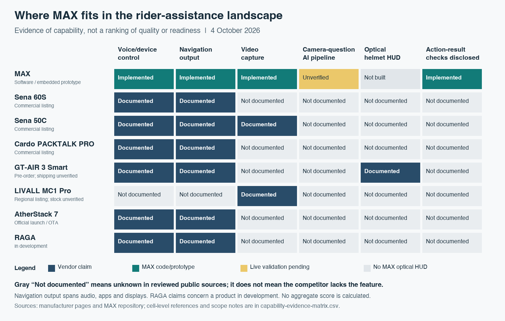
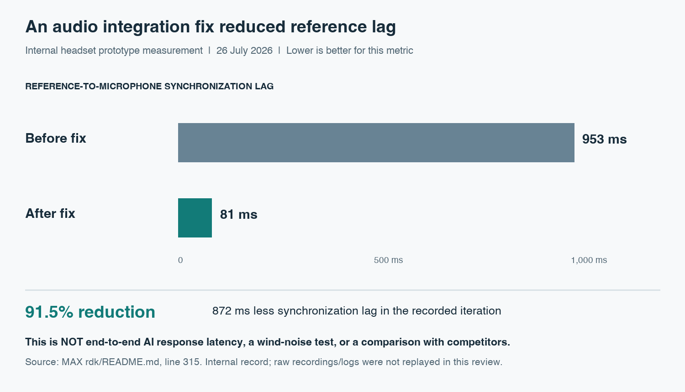

# MAX connects rider tasks through integration

**MAX’s strongest evidenced non-ARAS asset is its integrated assistant software: one coordinated voice connects navigation, supported device actions, media and phone-to-embedded hardware workflows. The available evidence does not establish head-to-head superiority over existing competitors.** The project and earlier conversations show substantial integration work, including device-result feedback, interruption handling and cross-device navigation state. These are credible engineering strengths today. Voice control, recording and navigation displays already exist in competing products, while Ather now advertises natural-language task execution. MAX should therefore sell a coherent rider workflow and a measurable development advantage, then substantiate competitive superiority through matched task tests. Live visual reasoning, on-road usability and final helmet hardware remain validation milestones.

_Prepared 4 October 2026. Scope excludes ARAS. Competitor statements are manufacturer claims accessed on that date; internal measurements retain their original dates. This is a selected comparison, not an exhaustive market census._

## BP-ready positioning: one assistant coordinates the riding experience

> MAX is developing an AI-assisted motorcycle helmet experience that brings navigation, supported voice commands, media and helmet-side hardware into one coordinated assistant. Our technical strength is the integration layer that connects these functions and manages their interactions, rather than any single feature in isolation.
>
> We have built shared interfaces across web, iOS, Android and an embedded prototype. Navigation instructions and assistant confirmations use a coordinated MAX voice, while phone-to-display integration carries route, rider position and next-turn information to an independently rendered display. Supported device actions return explicit success or failure outcomes, allowing the assistant to correct its response when execution fails. Riding modes, interruption handling and controls on unsolicited visual commentary provide a foundation for an interaction experience tailored to riding.
>
> This work is supported by repeatable software validation. A focused review on 4 October 2026 passed 70 tests covering action reconciliation, navigation safeguards, visual-call controls, audio-loop handling, companion navigation, memory and display casting. An earlier internal audio integration measurement recorded a reduction in reference-to-microphone synchronization lag from 953 ms to 81 ms; this demonstrates progress on the prototype’s audio pipeline, not end-to-end AI response speed.
>
> Established competitors already offer strong intercom, voice-control, recording and navigation capabilities. MAX’s opportunity is to make these activities work together as a coherent assistant across phone and helmet-side hardware, with camera-context assistance as a further development track. Our next milestones are to validate task completion, false-success announcements, response time and recovery under realistic conditions, and to complete live vision and helmet hardware integration. The current evidence supports an integrated software and embedded prototype; competitive performance leadership remains to be demonstrated.

_Evidence supporting this copy: [project overview](/Users/admin/doubao/README.md:30), [action reconciliation](/Users/admin/doubao/server/device-actions.ts:694), [casting architecture](/Users/admin/doubao/docs/rdk-hud-casting.md:1), [audio measurement](/Users/admin/doubao/rdk/README.md:315), and [focused test record](/Users/admin/doubao/research_notes/Helmet%20technical%20competitive%20advantage/project.md)._

## Three engineering strengths survive a close evidence review

**First, MAX connects supported spoken commands to observable device outcomes.** Its shared contract defines 15 action types, with platform-specific availability. Actions distinguish success, failure, denial and unsupported outcomes; failed execution can replace the assistant’s reply with a result-derived correction. A separate heuristic guard interrupts detected invented navigation guidance. This is a useful foundation for trustworthy task execution, but it does not guarantee zero hallucinations. The current action extractor is a deterministic command grammar behind a replaceable interface, not a demonstrated general-purpose LLM tool agent. The defensible claim is grounded execution of supported actions, not superior language understanding. ([Action grammar and contract](/Users/admin/doubao/server/device-actions.ts:1), [reconciliation](/Users/admin/doubao/server/device-actions.ts:694), [navigation guard](/Users/admin/doubao/server/nav-fabrication-guard.ts:1))

**Second, MAX coordinates voice and navigation across devices.** Earlier chats explicitly sought one MAX voice instead of competing map and assistant voices, then documented fixes to overlapping announcements, stale reroutes and interrupted speech. The display prototype independently renders navigation state from the phone, and later work added remembered pairing and reconnection. This is evidence of solving product integration problems that a simple assistant demo leaves unresolved. It is not evidence that MAX is phone-independent: GPS, routing and service dependencies remain. The RDK-connected screen is a bench display, not validated helmet optics. ([Fix MAX navigation voice conflicts](codex://threads/01a09f49-ad6a-73a3-8ca8-dff0bea9f993), [Add map casting to RDK HUD](codex://threads/01a0b251-adaa-7ff2-8063-924e6c0f2e7a), [casting limits](/Users/admin/doubao/docs/rdk-hud-casting.md:63))

**Third, MAX has riding-specific interaction controls and a repeatable validation process.** Wake-word addressing, bounded follow-up conversations, riding response modes and interruptible speech are implemented. Visual watching is disabled by default, with limits on calls and spoken observations. These are design controls, not measured reductions in distraction or cost. QA evidence, integrity checks and policy replay strengthen release discipline; public competitor silence about internal QA cannot establish that MAX’s process is better. A fresh focused run passed **70/70 tests in seven files** at HEAD `b7743cc` on 4 October 2026. Those unit and synthetic checks support software behavior, not wind-noise accuracy or road reliability. ([Interaction features](/Users/admin/doubao/README.md:30), [vision controls](/Users/admin/doubao/server/vision-governor.ts:33), [QA infrastructure](/Users/admin/doubao/README.md:234), [test record and exact command](/Users/admin/doubao/research_notes/Helmet%20technical%20competitive%20advantage/project.md))

Camera context and China-local service integration are **promising positioning hypotheses**. The camera-question and gallery-description pipelines exist, but the live Ark vision path remains unverified. Doubao and AMap fit the current implementation; they do not establish a proprietary model or exclusive advantage. QQ Music support varies by platform and lacks full SDK/API integration. AMap currently supplies **car routes**, so motorcycle-restricted roads are not represented. ([Vision limitation](/Users/admin/doubao/server/vision.ts:36), [QQ Music limits](/Users/admin/doubao/docs/qq-music.md), [navigation limitations](/Users/admin/doubao/docs/code-audit-2026-09-24.md:24))

## Competitors already cover the individual features

_Figure 1. Evidence categories describe what was found, not performance scores. Vendor-documented features are not independently verified. “Not documented” never means absent. Broad navigation presentation includes phone-assistant audio and route software as well as displays; it does not imply equivalent navigation capability. MAX implementation cells are code/prototype evidence, not production acceptance. Sources and cell-level scope are included in the accompanying CSV._

| Comparator                                                                       | What it already establishes                                                                                      | Consequence for MAX’s positioning                                                                                                                |
| -------------------------------------------------------------------------------- | ---------------------------------------------------------------------------------------------------------------- | ------------------------------------------------------------------------------------------------------------------------------------------------ |
| [Sena 60S](https://www.sena.com/product/60s/)                                    | Voice commands, audio multitasking, AI noise cancellation and established intercom functions; commercial listing | Voice control and noise processing alone are not distinctive. Test utility against intercom plus phone assistant.                                |
| [Sena 50C](https://www.sena.com/product/50c/)                                    | Integrated intercom/camera, 4K30 recording, 12 MP stills and smartphone-assistant access; commercial listing     | Integrated recording is established. MAX must demonstrate a better supported capture workflow, not camera novelty.                               |
| [Cardo PACKTALK PRO](https://cardosystems.com/products/packtalk-pro)             | Natural Voice Operation for common audio/call tasks; commercial listing                                          | Hands-free operation is an existing baseline. Compare task completion and interruption recovery.                                                 |
| [EyeLights / SHOEI GT-AIR 3 Smart](https://eye-lights.com/products/gt-air3smart) | Advertised optical HUD, navigation and Siri/Google assistant support; observed pre-order/sold-out state          | MAX’s bench screen cannot substantiate optical-display parity or superiority. Shipping was not established.                                      |
| [LIVALL MC1 Pro](https://de.livall.com/en/products/mc1-pro)                      | Helmet-integrated 1080p/720p camera and intercom; regional manufacturer listing                                  | Electronics inside a helmet are not themselves a unique proposition. Current stock was not verified.                                             |
| [AtherStack 7](https://www.atherenergy.com/ota-updates)                          | Natural-language navigation, vehicle settings and media on selected Ather vehicles                               | This is a substantive assistant competitor. MAX’s potential portability must be demonstrated; broader language understanding is not established. |
| [RAGA](https://ragarider.com/)                                                   | Developing a conversational rider assistant for route planning/changes using existing headsets                   | Hardware-independent rider AI is not uncontested. RAGA is an emerging positioning comparator, not a verified shipping benchmark.                 |

Ather’s official launch post is dated 10 June 2026, while its OTA page labels AtherStack 7 July 2026. Compatibility and iOS restrictions matter when selecting a test configuration. RAGA’s site states that it is in development. This maturity difference is preserved in the chart rather than blending prototypes, announced products and commercial listings into one ranking. ([Ather launch and compatibility](https://forum.atherenergy.com/t/voice-on-ather-now-live-atherstack-7/436757), [RAGA status](https://ragarider.com/))

Published hardware numbers should serve as **benchmark references**, not a MAX victory chart. Sena advertises 24 hours of Bluetooth or 17 hours of Mesh talk time for the 60S; the 50C specifies 100 minutes of video recording. These are different workloads. MAX has no reviewed equivalent final-hardware endurance measurement, so an advantage cannot be calculated. Likewise, a 68 g intercom main unit and a complete helmet are not comparable mass boundaries. ([Sena 60S specifications](https://www.sena.com/product/60s/), [Sena 50C specifications](https://www.sena.com/product/50c/))

## The numerical improvement proves integration progress

**The documented internal audio synchronization lag fell from 953 ms to 81 ms: a 872 ms, or 91.5%, reduction.** The July 26, 2026 record attributes the improvement to pacing playback and the echo-cancellation reference to actual audio writes. This is meaningful evidence that the team diagnosed and corrected an embedded audio integration problem. It is **not AI response latency**, a wind-noise result, or a competitor comparison. Raw recordings and instrument logs were not replayed in this review, so the chart represents the documented internal measurement. ([Measurement and implementation record](/Users/admin/doubao/rdk/README.md:315), [playback rationale](/Users/admin/doubao/rdk/agent/src/audio/playback.ts:34))

The same development record describes one live headset session achieving talk-over interruption without self-echo replies. It also warns that strong synthetic echo-cancellation results did not predict real rider-voice preservation. That distinction is useful: the strongest technical narrative is an engineering team that tests integration behavior and corrects failures, not a claim of already solved motorcycle acoustics. A later 24.9 ms observation is excluded because its improvement was not understood or confirmed. ([Live acceptance and caveats](/Users/admin/doubao/rdk/README.md:226), [synthetic-test limitations](/Users/admin/doubao/rdk/README.md:354), [unconfirmed observation](/Users/admin/doubao/rdk/README.md:331))

## Matched rider tasks can turn the positioning into proof

| Evidence needed                               | Matched comparison                                                                                    | Reportable result                                                                                                                           |
| --------------------------------------------- | ----------------------------------------------------------------------------------------------------- | ------------------------------------------------------------------------------------------------------------------------------------------- |
| Supported voice tasks actually complete       | MAX vs Sena/Cardo plus phone assistant; Ather where the task and vehicle setup are comparable         | Completion rate, false-success announcement rate, sample count and confidence intervals; separate unsupported tasks from execution failures |
| Responses arrive in useful time               | Same task, phone/network conditions and clearly defined start/end events                              | Command-to-confirmed-action median and p95; not audio-reference lag                                                                         |
| Conversation survives realistic interruptions | Controlled noise levels, media/intercom interruptions, language/accent variation and degraded network | Recovery rate, unintended activations, cancellation success and repeat-command count                                                        |
| Camera context is useful                      | Validate MAX live provider first; compare capture workflows with Sena 50C                             | Question accuracy and unsupported-answer rate on a labelled scene set; capture-to-retrieval completion                                      |
| Hardware supports a viable product            | Final integrated helmet under a defined simultaneous workload                                         | Whole-system mass, balance, temperature and runtime; display readability and applicable certification evidence                              |

These are proposed studies, not completed results. Freeze supported tasks and pass criteria before testing; retain failed runs and publish configurations. Record single-feature performance separately from the combined workflow that MAX intends to improve. The current physical acceptance matrix still contains pending locked-phone, rerouting and network-loss checks, and no reviewed controlled test establishes lower distraction, safer riding, superior battery life or production readiness. ([Pending acceptance matrix](/Users/admin/doubao/docs/rdk-ios-companion-acceptance.md:379))

**The commercial opportunity is to make the combined workflow measurably easier to complete.** The next BP revision should replace broad superiority language with a small set of matched rider-task results. Repeated gains across navigation, capture and interruptions would support differentiation more convincingly than adding another isolated feature. Evidence of proprietary data rights, protected IP or switching value would be needed before calling the integration work a defensible moat.

---

**Review coverage and source notes.** This report synthesizes repository evidence, a focused 70-test run, manufacturer pages and seven relevant earlier chats selected from the 50 most recent non-pinned chats. Two richer chats were paginated. Older non-archived chats beyond that window and ChatGPT archives were not reviewed; this is not a complete conversation-history audit. See the [project research](/Users/admin/doubao/research_notes/Helmet%20technical%20competitive%20advantage/project.md), [competitor research](/Users/admin/doubao/research_notes/Helmet%20technical%20competitive%20advantage/competitors.md) and [conversation research](/Users/admin/doubao/research_notes/Helmet%20technical%20competitive%20advantage/conversations.md). Manufacturer pages describe advertised capabilities rather than independent tests; LIVALL details came from an initially retrieved regional listing whose later fetch failed. No matched competitor performance dataset was found. Shared web/relay and native audit totals include broader project scope, so they are deliberately not charted as non-ARAS performance.
